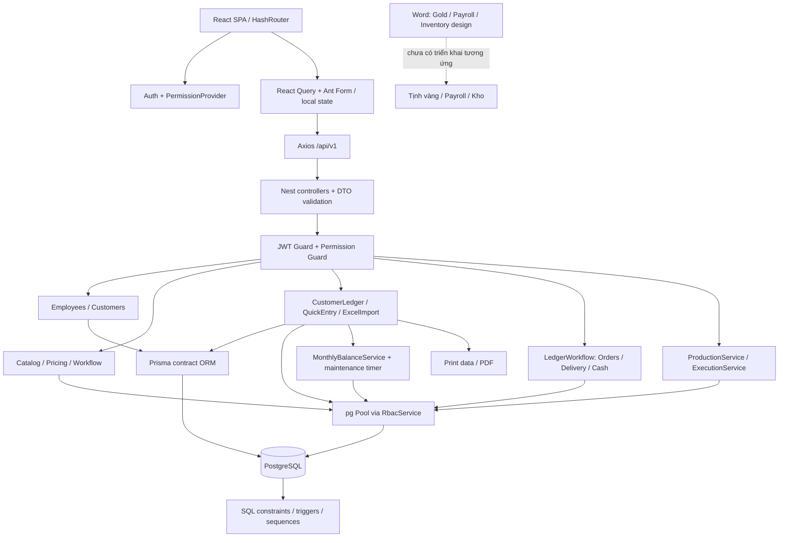

# FACTORY MANAGEMENT — PROJECT AUDIT FOR GOLD REFINING

Ngày audit: **16/11/2026**, múi giờ Asia/Saigon. Phạm vi: code và tài liệu trong workspace `C:/Users/QuangPham/Desktop/factory-management`.

Đây là báo cáo đọc tĩnh phục vụ chuyển ngữ cảnh để lập kế hoạch. Không triển khai Tịnh vàng, không chạy migration/seed, không kết nối database, không khởi động ứng dụng, không sửa source/config/dependency. File báo cáo này là đầu ra duy nhất được tạo trong đợt audit.

Quy ước bằng chứng: **[E01]…[E32]** trỏ tới file và symbol trong mục 16. Các đường dẫn trong chỉ mục là đường dẫn tuyệt đối. “Implemented” chỉ xác nhận có triển khai trong code, **không xác nhận chạy production hoặc test đã đạt**.

Phân loại: **Implemented** = có logic/persistence thực trong phạm vi nêu; **Partial** = chỉ hoàn thành một phần chu trình; **Stub/Mock** = có giao diện/endpoint nhưng chưa có nghiệp vụ thật hoặc chỉ dữ liệu giả (báo cáo phân biệt rõ hai trường hợp); **Not Implemented** = chưa tìm thấy triển khai trong các nguồn đã kiểm tra; **Unknown / Chưa xác minh** = không đủ bằng chứng, đặc biệt trạng thái database/runtime/production.

## 1. Executive Summary

**Dự án có nền tảng để bắt đầu phân tích và lập kế hoạch Tịnh vàng, nhưng chưa có nền tảng tồn vàng/ledger vàng toàn xưởng hoàn chỉnh để chỉ việc nối thêm màn hình.**

- Frontend React + Ant Design và backend NestJS + PostgreSQL có auth/RBAC, danh mục, khách hàng, sổ giao dịch, đơn hàng/giao hàng/thu tiền và sản xuất thực sự. Backend có cả Prisma 8 RC contract ORM và SQL trực tiếp qua `pg`; không phải ứng dụng Prisma Client CRUD thông thường. [E01–E04]
- **Tịnh vàng chưa được triển khai trong source/schema/migration được kiểm tra.** Hai tài liệu Word có thiết kế `gold_daily_reconciliations`, cân/bì, snapshot thợ và `gold_variance_ledger`, cùng API `/gold/...`; đó là thiết kế, chưa phải tính năng hoạt động. [E02, E03, E29]
- Dữ liệu vàng hiện nằm ở hai miền riêng: **công nợ vàng khách hàng** trong `customers_ledger` và **giao/nhận, chênh lệch theo thợ/công đoạn/lô** trong các bảng `batch_*`. Chưa thấy ledger chung nối hai miền, tồn két/kho vàng hay luồng phân kim. [E06–E10, E15–E18]
- Sổ lương thợ và vật dụng có tab frontend/read-model kỳ vọng, nhưng backend hiện không có endpoint tương ứng. Không được coi các tab đó là payroll/kho đã hoàn thiện. Tiền công sản xuất có bút toán thực tế riêng, chưa có kỳ lương/khấu trừ hao/chi lương. [E11, E18]
- Chống trùng đã có **theo từng nguồn**: request UUID, intent hash, unique index, khóa giao dịch và version. Chưa có cơ chế chứng minh cùng một lượng vàng vật lý không bị ghi nhận ở nhiều module/nguồn khác nhau. [E06, E08–E10, E16, E22]
- Cần đặc biệt bảo vệ lịch sử: công nợ chính thức hiện bao gồm `PENDING`; số dư tháng là cache có thể tính lại; xóa giao dịch có thể xóa vật lý; đơn vị/precision hiển thị khác precision lưu trữ; thiết kế Word dùng mô hình giao việc cũ khác production hiện tại. [E06, E07, E10, E17, E19, E20, E29]

**Giới hạn xác minh:** chưa xác minh database thực tế đã áp dụng migration nào, số bản ghi, dữ liệu lỗi/cũ, môi trường triển khai, quyền người dùng thực tế, test pass/fail hay luồng runtime. Các báo cáo cũ nói đã áp dụng localhost/build thành công chỉ là bằng chứng lịch sử do repository ghi lại. Không suy ra trạng thái hiện nay hoặc production.

## 2. Repository & Tech Stack

### 2.1 Cấu trúc

Workspace gồm `backend/`, `frontend/`, hai tài liệu Word ở gốc, các tài liệu triển khai, snapshot source cũ, fixture và artifact in ấn. Có `.git` trong backend; không thấy `.git` ở gốc hoặc frontend khi kiểm tra thư mục trực tiếp. Không xác minh commit/deployment tương ứng. Không tìm thấy `AGENTS.md` trong inventory ngoài dependency và ở thư mục cha trực tiếp.

Hai package được quản lý riêng, có `package-lock.json` riêng; không thấy root package/workspace orchestration. Không có bằng chứng microservice hoặc event bus. Không dùng file trong `node_modules`, `docs/source-before-refactor` hoặc artifact `tmp` để kết luận tính năng hiện hành. [E01, E02, E30]

### 2.2 Stack xác minh từ manifest và entry point

| Thành phần | Khai báo phiên bản / cách dùng | Bằng chứng |
|---|---|---|
| Frontend | React `^19.2.8`, React DOM `^19.2.8`, TypeScript `~6.0.2`, Vite `^8.3.0` | E01 |
| Router | `react-router-dom ^7.18.4`, `HashRouter` | E01, E03 |
| UI | `antd ^6.6.5`, icons `^6.3.4`, dnd-kit cho workflow/reorder | E01, E12 |
| Server state | TanStack React Query `^5.104.1`; form/local state bằng React + Ant Form | E01, E03 |
| HTTP | Axios `^1.20.0`; Bearer interceptor, timeout 20s | E04 |
| Backend | NestJS common/core/platform-express `^12.0.1`; TypeScript `^6.0.2` | E01, E02 |
| Database | PostgreSQL, SQL dùng UUID, NUMERIC, JSONB, timestamptz, advisory lock, trigger | E05, E22–E27 |
| ORM thực dùng | `@prisma/orm-postgres ^8.0.0-rc.17`, contract `contract.prisma/json/d.ts` | E01, E05 |
| Dependency Prisma khác | `@prisma/client`, adapter-pg `^7.10.0`, CLI `prisma ^8.0.0-rc.22`; có dependency không có nghĩa runtime dùng Client v7 | E01, E05 |
| Raw DB | `pg ^8.23.1`; `RbacService.pool` được nhiều domain service dùng | E05, E21 |
| Validation | class-validator `^0.15.1`, class-transformer `^0.5.1`; global ValidationPipe | E01, E02 |
| Authentication | Nest JWT, Argon2 | E21 |
| Excel | ExcelJS `^4.4.0`; preview/confirm nhập sổ | E01, E10 |
| Test | Backend Vitest `^4.1.11`, Nest testing/Supertest; frontend Node test runner | E01, E28 |

Đây là **range trong manifest**, không khẳng định phiên bản package đang được runtime nạp; chưa đối chiếu đầy đủ lockfile và môi trường cài đặt. Không cần tra cứu web cho audit trạng thái repository.

### 2.3 Môi trường, migration và seed

- Backend nạp `dotenv/config`; tên biến tham chiếu gồm `DATABASE_URL`, `JWT_SECRET`, `NODE_ENV`, `PORT`, `CATALOG_IMAGE_DIR`. Không đọc/in nội dung `.env`, credential hoặc token. Frontend dùng `VITE_API_BASE_URL`, proxy đọc `API_PROXY_TARGET`. [E02, E04, E05, E12, E21]
- Global API prefix `/api/v1`; Swagger chỉ bật khi `NODE_ENV=development`, đường dẫn `/api/docs`; cổng mặc định 3000. Không thấy cấu hình CORS trong entry point đã đọc. [E02]
- Có explicit SQL migrations, runner `.mjs`, Prisma contract snapshots và `migrations/app/refs/db.json`. SQL chứa constraint/trigger mà `contract.prisma` không mô tả hết. Runner được README mô tả kiểm tra localhost, checksum, lock và transaction; không chạy trong audit. [E05, E27]
- Có seed và script hash password; không chạy hoặc trích dữ liệu seed có khả năng nhạy cảm. Chưa xác minh seed đã được dùng, tài khoản mặc định hoặc dữ liệu thực tế. [E27]

## 3. System Architecture

**Backend:** modular monolith qua `AppModule`: Prisma, RBAC, Auth, Customers, CustomerLedger, Users, Employees, Catalog, Production. Đơn hàng, giao hàng và cash được đăng ký qua các controller của CustomerLedgerModule, không có service/module độc lập tương ứng tên nghiệp vụ. [E02, E08]

**Frontend:** page → feature service/hook → Axios; React Query giữ cache server, Ant Form/`useState` giữ draft. Có workspace và guard riêng cho sổ khách hàng; không thấy Redux/Zustand. Router/layout/permission không tự phát hiện module mới: danh sách route, `PageKey`, logic nhận diện page, sidebar đều khai báo tường minh. [E03, E04, E31]

**API contract:** thường `{data,meta}`, nhưng không hoàn toàn thống nhất. ORM trả camelCase; SQL workflow thường snake_case; frontend có lớp normalize và type/read-model riêng. Pagination có nơi ở SQL, có nơi tải toàn bộ rồi slice trên server/client. Không thấy global interceptor chuẩn hóa tất cả response/error thành envelope của tài liệu Word. Nest exceptions chủ yếu 400/401/403/404/409; QuickEntry có lỗi từng block. [E02, E04, E06, E09, E12, E29]

**Transaction:** raw `BEGIN/COMMIT/ROLLBACK`, advisory lock theo domain/customer, row lock, tái kiểm tra quyền và optimistic version. Một số read nhiều truy vấn dùng `REPEATABLE READ READ ONLY`. Không có Unit of Work dùng chung cho mọi domain; không thể giả định các thao tác ORM và raw SQL tự chia sẻ một transaction. [E06, E08, E09, E12, E16, E21]

**Background:** có timer in-process bảo trì số dư tháng: tick 60 giây, rebuild batch 50 khách, khi xong một lượt nghỉ khoảng một giờ; lỗi thử lại sau khoảng 60 giây. Có khóa DB trong rebuild. Chưa thấy queue bền vững, outbox hoặc scheduler phân tán. [E07]

**Naming:** frontend PascalCase component, camelCase helper; DB snake_case, UUID; API plural/kebab-case và action subresource; permission theo domain, ví dụ `customer_ledger.create`, `production.materials.manage`. Các pattern có khác biệt lịch sử, không phải mọi domain dùng cùng cấu trúc. [E03, E08, E15, E21]

## 4. Module Implementation Matrix

| Module | Frontend | Backend / nghiệp vụ | Trạng thái tổng thể | Bằng chứng |
|---|---|---|---|---|
| Nhân viên | Directory/detail/form/tài khoản | List/detail/create/update, sinh mã | Implemented cho hồ sơ; Partial cho toàn bộ profile | E11 |
| Kho vật dụng/đồ nghề | Tab vật dụng nhân viên | Không thấy supplies/inventory API | Stub giao diện tích hợp; Not Implemented nghiệp vụ kho | E11, E29 |
| Mẫu mã | Catalog, nhóm, ảnh, workflow | CRUD/status, giá mặc định, workflow revision | Implemented | E12–E14 |
| Mẫu sản phẩm vật lý | Route cũ redirect Mẫu mã | Không thấy entity/API product sample | Not Implemented riêng | E03, E05, E29 |
| Thành phần/cấu kiện/BOM | Catalog components, BomPanel | CRUD/status, BOM/items | Implemented cho danh mục/công thức; không phải tồn kho | E12 |
| Đơn hàng | OrdersPage | Tạo/list/detail/status/split | Partial: chưa có reservation/tồn thành phẩm | E08, E13 |
| Sản xuất | Lô/create/detail/workflow/giao nhận | Snapshot, assignments/output/material/reconciliation/labor | Implemented các luồng hiện có; Partial chu trình sản xuất đầy đủ | E15–E18 |
| Giao hàng | DeliveriesPage, report forms | Trips/events/report/approve | Partial: chưa có vòng đời gắn xuất tồn thật | E08 |
| Khách hàng | Directory/form/giá riêng | CRUD, tìm trùng tên, giá mẫu/nhóm | Implemented | E13 |
| Sổ giao dịch khách hàng | Summary/detail/quick/import/print/report | Công nợ vàng/tiền, nguồn hàng, thu/trả | Implemented; có giới hạn dữ liệu lịch sử | E06–E10 |
| Sổ lương thợ | Tab lương/ứng/khấu trừ | Không có payroll module; chỉ batch labor riêng | Stub tích hợp payroll; Partial dữ liệu nguồn tiền công | E11, E18 |
| Tịnh vàng/dòng vàng | Không thấy route/page | Không thấy entity/service/API tịnh; có dữ liệu vàng ở domain khác | Not Implemented Tịnh vàng; Partial theo dõi vàng cục bộ | E03, E05, E06, E16, E29 |
| Thu–chi/chi phí | CashPage, khoản thu/kỳ báo cáo | Thu công/hoàn công, duyệt và khóa kỳ | Partial: không phải sổ chi phí tổng quát | E08, E22 |
| Báo cáo/Dashboard | DailyGoldReport, summary, in sổ, cash report | Report vàng khách và báo cáo tiền | Partial: chưa có dashboard toàn xưởng/báo cáo vàng hợp nhất | E03, E07, E08, E24 |
| Cấu hình hệ thống | AccountsPage, permission matrix | Users/groups/roles/permissions | Partial: quản trị tài khoản có thật, không thấy cấu hình hệ thống tổng quát | E21, E31 |
| Khác phát hiện | Excel import; giá công theo khách/nhóm; workflow DAG; ảnh catalog | Triển khai trong các module trên | Implemented theo phạm vi từng chức năng | E09, E10, E12–E14 |

Không tìm thấy “mock API trả dữ liệu mẫu” đang vận hành cho các module thiếu. Tab có form/table/type và gọi endpoint không tồn tại được gọi **stub tích hợp**, không gọi là backend mock đã hoàn thiện.

## 5. Detailed Module Inventory

Tất cả endpoint sau đây có prefix `/api/v1`. Dấu `{id}` biểu thị path parameter. Với module chưa có, “không thấy” là kết quả kiểm tra registry, controller, schema và migrations, không phải chứng minh database bên ngoài không có bảng tự tạo.

### 5.1 Nhân viên

- Route: `/#/employees`, `/#/employees/:employeeId`; `EmployeesPage`, `EmployeesDirectory`, `EmployeeDetail`, `EmployeeForm`. `EmployeeAccountButton` nối tạo/quản lý tài khoản. [E03, E11]
- API: `GET/POST /employees`, `GET/PATCH /employees/{id}`, `GET /employees/{id}/account`. `EmployeesService.findAll/findOne/create/update/accountAvailability`; bảng `employees`, `users`. Quyền `employees.read/create/update`; kiểm tra account đòi thêm `users.create`. Mã `NV...` do backend sinh, không nhận mã tùy ý từ DTO. [E11, E27]
- Có hồ sơ/status/điện thoại/ngày vào làm, tìm kiếm, lọc và pagination. Chưa thấy endpoint xóa nhân viên; schema có `deleted_at` không đồng nghĩa API đã có xóa. [E11]
- `EmployeeWork/Payroll/Supplies/Activity` gọi `/employees/{id}/work|payroll|supplies|activity`; `EmployeesController` không đăng ký chúng. Chưa có bridge đưa production `batch_*` lên tab công việc/lương nhân viên. [E11]

### 5.2 Kho vật dụng và đồ nghề

- Có `EmployeeSupplies` hiển thị vật dụng đang giữ và lịch sử, có nhãn trừ lương. Không có route kho chính, `SuppliesService`, API `/supplies` hoặc `/supply-transactions` trong registry hiện tại. Không thấy bảng `supplies/supply_inventory/supply_transactions` trong schema/migrations đang triển khai. [E02, E03, E05, E11]
- Permission, bảng và API nêu trong Word là thiết kế. Chưa có logic nhập/xuất/tồn/bán vật dụng/khấu trừ payroll thực sự. [E29]

### 5.3 Mẫu mã và nhóm mẫu

- Route `/#/design-models`; `CatalogPage`, `CatalogForm`, `DesignGroups`, `DesignGroupDetail`, `ProductionWorkflowEditor`. [E03, E12, E14]
- API `GET/POST /design-models`, `GET/PATCH/DELETE /design-models/{id}`, `PATCH /design-models/{id}/status`, upload ảnh `POST /design-models/images` và `/{id}/images`; tương tự quản lý nhóm ở `/design-model-groups`. Bảng `design_models`, `design_model_groups`, `catalog_images`. [E12]
- `CatalogService` có SQL transaction, version, lock, audit; mã `MM...`. Có weight và giá mặc định; không phải master tồn vàng. Quyền `design_models.read/create/update/delete`, `design_models.groups.manage`. [E12]
- Workflow: `GET/PATCH /design-models/{id}/production-workflow`, `GET .../revisions`; tương tự nhóm. `ProductionWorkflowService` resolve `INHERIT/CUSTOM`, validate DAG, lưu revision JSON. Liên kết nguồn của lô sản xuất. [E14, E15]

### 5.4 Mẫu sản phẩm

`/product-samples/*` chỉ redirect tới `/design-models`. Không có `ProductSample` trong contract hoặc controller PUT product sample như Word thiết kế. Ảnh/weight trên `design_models` và field prototype của component không chứng minh có vòng đời mẫu vật lý độc lập. [E03, E05, E12, E29]

### 5.5 Cấu kiện và BOM

- Route `/#/components`; `CatalogPage`, `CatalogAttributesFields`, `InitialBomFields`, `BomPanel`. API CRUD/status/images `/components`; `GET/POST /design-models/{id}/boms`, `GET/PATCH /boms/{id}`. [E12]
- Bảng `components`, `boms`, `bom_items`; service `CatalogService`; quyền `components.read/create/update/delete`, `boms.manage`, đọc BOM theo `design_models.read`. Có quan hệ used-by và danh mục `COMPONENT/AUX_MATERIAL`. [E12, E23]
- Có lưu quantity/weight/unit, liên kết công thức theo mẫu. Chưa thấy tự xuất nguyên liệu/tính tồn theo BOM khi tạo lô hoặc tự nhập thành phẩm khi hoàn thành. [E12, E15, E16]

### 5.6 Đơn hàng

- Route `/#/orders`; `OrdersPage`, `OrderDesignSelect`; `LedgerOrdersController` gọi `LedgerWorkflowService.orders/order/createOrder/orderStatus/splitOrder`. API `GET/POST /orders`, `GET /orders/{id}`, `PATCH /orders/{id}/status`, `POST /orders/{id}/split`. [E08, E13]
- Quyền `orders.read/create/update/split`; bảng `orders`, `order_items`, `order_split_links`. Có line price/weight snapshot, tổng tiền công, chia đơn và liên kết nguồn khi giao. [E08, E22, E23]
- Không thấy finished-goods inventory, reservation, API reserve/release hay liên kết trực tiếp order với production batch. Không xem trạng thái đơn là bằng chứng đã giữ/xuất kho. [E05, E08, E15, E29]

### 5.7 Sản xuất

- Routes `/#/production-batches`, `/new`, `/:id`; `ProductionBatchesPage`, `BatchCreatePage`, `ProductionBatchDetailPage`, `BatchExecutionSection`, `StageOperations`, `ExecutionGraph`, `CombinedGoldForm`. [E03, E15, E16]
- Batch API: `GET/POST /production-batches`, `GET /workflow-preview`, `GET/PATCH /{id}`, `GET/PATCH /{id}/workflow`, `GET /{id}/status-history`, `/audit-history`, `PATCH /{id}/status`. `ProductionService` quản lý snapshot, revision, trạng thái và source version. [E15]
- Execution base `/production-batches/{id}/execution`: `GET /`; POST `stages/{stepId}/action|assignments|outputs|materials|transfers|losses|labor|work-gold|gold-receipts|reconciliation`; POST `material-reversals`; POST `transactions/{transactionId}/edit|delete`. [E16, E17]
- Quyền `production.read/create/update/workflow.update/status.update/execution.manage/assignments.manage/output.manage/materials.manage/adjustments.manage/losses.manage/labor.manage/reconciliation.manage`. Từng action có thể kiểm tra thêm quyền cho vàng/sản lượng/phân công. [E16, E21]
- Có workflow DAG snapshot, AND-join, sản lượng, thợ, giao nhận nhiều lần, chốt/mở lại Hao–Heo, tiền công dự kiến và bút toán tiền công thủ công. Chưa có QA/rework/nhập kho thành phẩm/order reservation/payroll integration; không tự hoàn tất toàn lô từ sản lượng công đoạn. **Riêng `PATCH /production-batches/{id}/status` là Stub nghiệp vụ:** `ProductionService.changeStatus` kiểm tra quyền/version rồi luôn ném ConflictException vì state machine toàn lô chưa được xác nhận. Không coi sự tồn tại endpoint/history table là khả năng đổi trạng thái toàn lô đã hoạt động. [E15–E18, E26]

### 5.8 Giao hàng

- Route `/#/deliveries`; `DeliveriesPage`, `ReportDeliveryForm`, `ManualDeliveryForm`, `LedgerWorkflowPanel`. API `GET/POST /delivery-trips`, `POST /delivery-trips/{id}/events`; chọn đơn `/customer-ledger/delivery-orders`; report/record `/customer-ledger/orders/{id}/report-delivery|record-delivery`. [E08]
- Bảng `delivery_trips`, `delivery_trip_orders`, `delivery_events`, submissions và ledger. Quyền `delivery.manage`, `delivery.report`; duyệt sổ `customer_ledger.approve`, khoản thu kèm có kiểm tra `cash.approve` theo luồng. [E08]
- Có chuyến/người giao/events và báo giao, duyệt/khai sai. Luồng nhập từ sổ có thể record trực tiếp bằng quyền tạo sổ, không qua approval độc lập giống report delivery. Không có đủ bộ start/complete/cancel trip trong API Word và chưa có xuất kho thật. [E08, E09, E29]

### 5.9 Khách hàng

- Route `/#/customers`; `CustomersPage`, `CustomersDirectory`, `CustomerForm`, giá mẫu/nhóm. API `GET/POST /customers`, `GET/PATCH/DELETE /customers/{id}`, `GET /customers/duplicate-names`; CRUD cấu hình `/{id}/labor-prices/...`, `/{id}/group-labor-prices/...`. [E13]
- `CustomersService`, `CustomerLaborPricesService`, `LaborPricingService`; bảng `customers`, `customer_model_labor_prices`, `customer_group_labor_prices`; quyền `customers.read/create/update/delete`. Sinh mã `KH...`, soft delete khách hàng. [E13, E27]
- Giá công hiệu lực ưu tiên giá riêng khách+mẫu → khách+nhóm → mẫu → nhóm mặc định; 0 được giữ, null là thiếu cấu hình. Đây là giá bán công khách, độc lập giá công thợ. [E13, E18]

### 5.10 Sổ giao dịch khách hàng

- Routes `/#/ledger`, `/#/ledger/:customerId`; summary/tab khách, ngày, drawer chi tiết, quick entry, delivery/return/money forms, Excel import, print. [E03, E06–E10, E24]
- API đọc: `GET /customer-ledger/summary|daily-gold|customer-layout`, `GET /customer-ledger/customers/{customerId}`, `.../print-data`, `GET /customer-ledger/entries/{id}`. Ghi: `POST .../customers/{customerId}/entries`, `PATCH/DELETE .../entries/{id}`, `PATCH /customer-ledger/customer-layout`. [E06, E07]
- Quick: `POST /customer-ledger/quick-entries`, `GET .../options`, `POST .../labor-prices`, `POST .../{id}/resubmit`. Import: `POST /customer-ledger/excel-import/preview|confirm`. [E09, E10]
- Workflow: `GET /customer-ledger/entries/{id}/workflow`; POST `.../approve|incorrect|payments|goods-returns`; GET `returnable-deliveries`, `goods-returns/{id}`; POST `goods-returns/{id}/void|approve`; manual delivery endpoint. [E08]
- PDF: `POST /customer-ledger/print/pdf`, quyền `customer_ledger.read`; `LedgerPdfService.render` dùng Chromium headless cài trên máy backend, có thể cấu hình bằng tên biến `LEDGER_PDF_BROWSER_PATH`. Không có Chromium thì service trả lỗi unavailable; chưa xác minh môi trường audit xuất PDF được. [E24]
- Quyền `customer_ledger.read/create/update/reverse/approve/collect/returns.manage/fx.manage`, thêm cash/delivery theo nguồn; bảng chi tiết tại mục 6. Có nghiệp vụ và persistence thật, không mock. Chưa liên kết tồn vàng toàn xưởng. [E06–E10]

### 5.11 Sổ lương thợ

- `EmployeePayroll` có bộ lọc kỳ, thu nhập/ứng/khấu trừ/hao/bù và type `PayrollPeriod/PayrollLine`, nhưng gọi endpoint payroll chưa được backend đăng ký. Không có route payroll độc lập, kỳ payroll, approval/chốt/chi lương hoặc `PayrollDeduction` trong contract/migrations. [E11]
- `ExecutionService.labor` có bút toán tăng/giảm tiền công sản xuất, bảng `batch_labor_entries`, quyền `production.labor.manage`. Không phải bảng lương; không tự tạo khấu trừ hao từ reconciliation. [E16, E18]
- Các bảng/quy tắc payroll trong Word là thiết kế chưa được hiện thực hóa. [E29]

### 5.12 Tịnh vàng và dòng vàng

Không thấy route, page, controller, service, entity/migration cho `RefiningSession`, `gold_daily_reconciliations`, `gold_scale_entries`, `gold_containers`, `gold_tare_presets/usages`, `gold_variance_ledger`. Các API `/gold/reconciliations`, close/reopen/refresh snapshot chỉ có trong Word. Không thấy permission vàng chung `gold.*` được đăng ký để vận hành module đó. [E02, E03, E05, E21, E29]

Dữ liệu vàng cục bộ có thật được mô tả mục 7; không đồng nhất với module tịnh vàng hoặc phân kim.

### 5.13 Thu–chi và chi phí

- Route `/#/cash`; `CashPage`, `WorkflowMoneyForms`. API `GET /cash/transactions|outstanding|payments`, `GET /cash/payments/{id}`, POST `/cash/entries/{id}/payments`, `/cash/payments/{id}/approve|void`, PATCH `/cash/payments/{id}/fx`; GET/POST `/cash/periods`, GET `/{id}/report`, PATCH `/{id}/fx`, POST `/{id}/close`. [E08]
- Bảng cash categories/transactions/report periods, payments/refunds/fx revisions. Quyền `cash.read/collect/approve/refund.approve/periods.manage`, `customer_ledger.fx.manage`. Thu/hoàn có source và giữ nguyên tệ, tổng hợp BAHT theo tỷ giá kỳ. [E08, E22]
- Chưa có API tạo chi phí tùy ý/category CRUD tổng quát như Word; CHECK cash yêu cầu payment/refund nguồn, nên không thể coi là sổ mua vàng/chi phí phân kim/chi lương dùng ngay. Chưa có attachments chứng từ tổng quát. [E22, E29]

### 5.14 Báo cáo và Dashboard

Có `DailyGoldReport` dùng `MonthlyBalanceService.daily`, summary công nợ và tiền công, in sổ/PDF, cash period report, timeline/history sản xuất. Không thấy route dashboard riêng hoặc báo cáo hợp nhất vàng tồn két + khách + thợ + tinh luyện. `daily-gold` là **báo cáo công nợ vàng khách hàng**, không phải tịnh vàng toàn xưởng. [E03, E07, E08, E24]

### 5.15 Cấu hình và tài khoản

Route `/#/system/accounts`, `AccountsPage`, `PermissionMatrix`, modal tạo tài khoản. API auth `/auth/login`, `/auth/me`, `/auth/me/permissions`; users list/create/detail/update/delete, status/password/roles/group/direct permissions/effective permissions; roles/groups và permission catalog. `UsersService/AccessService/RbacService`; schema users/roles/groups và bảng nối. Quyền quản trị cụ thể tại catalog. Không thấy setting store tổng quát, cấu hình tuổi vàng/đơn vị/công thức tịnh vàng. [E21, E31]

## 6. Database Schema & Relationships

### 6.1 Nguồn định nghĩa và cách đọc

Schema ORM hiện tại ở [E05]. **Phải đọc thêm SQL** [E22–E27]: nhiều bảng nghiệp vụ dùng raw SQL không có model trong contract, ví dụ orders/cash/security audit/import và transaction adjustments. Không dùng thiếu model ORM để kết luận bảng không tồn tại. Ngược lại, file migration có bảng không chứng minh database runtime đã áp dụng.

Quy ước bảng dưới: `N20 = NUMERIC(20,4)`, `N24 = NUMERIC(24,4)`, `N30 = NUMERIC(30,4)`; trọng lượng vàng `g`; tuổi vàng `%`; tiền có mã currency, giá công thường trên 15g. PK mặc định UUID `id` trừ nơi ghi khác. FK SQL là bằng chứng quan hệ vật lý; không phải mọi UUID trong contract đều có relation ORM.

### 6.2 Bảng lõi, khách hàng, vàng và nguồn chứng từ

| Bảng thực tế | Field chính / kiểu | PK, FK, constraint/index / trạng thái | Nguồn |
|---|---|---|---|
| `customers` | code varchar(50), name varchar(180), phone/address/status/note, created/updated/deleted timestamptz | PK id; unique customer_code; mã bất biến qua trigger; soft delete; không có version integer riêng | E05, E13, E27 |
| `employees` | employee_code varchar(50), full_name varchar(180), phone, start_date date, role_label, status/note/timestamps | PK id; unique code; sinh sequence; soft delete field; không có payroll balance trong bảng | E05, E11, E27 |
| `users` | username varchar(100), password hash (không trích giá trị), employee_id uuid?, status, login cooldown, password_changed_at, timestamps | FK employee; unique username; partial unique employee khi chưa xóa; username immutable; soft delete | E05, E21, E25 |
| `customers_ledger` | customer_id uuid, business_date date, occurred_at timestamptz, transaction_type varchar(50), gold_weight_g N20; actual_weight_g N20?, purity_percent NUMERIC(7,4)?, recovered_exact_gold_g NUMERIC(30,10)? | FK khách, created/updated/reversed/approved user; request_id uuid? partial unique; customer/date indexes; không soft-delete field; reversed_at/by tồn tại; source ref UUID đa hình; approval status | E05, E06, E22 |
| `customers_ledger` phần công | labor_amount_due/paid N20, currency char(3), payment_status; reference_type varchar(50)/reference_id uuid; description/note | Vàng và công tách field; tiền chi tiết lấy payment/refund; source ORDER_DELIVERY unique theo reference_id; actual/purity exact có CHECK | E05, E08, E22 |
| `customer_ledger_monthly_balances` | customer_id uuid, period date đầu tháng, closing_gold_g N30, calculated_at timestamptz, is_dirty bool | PK id; FK khách; unique(customer,period); partial valid index; trigger invalidation khi ledger insert/update/delete; chỉ tháng đã qua | E07, E22 |
| `orders` | order_code varchar(50), customer_id, status/payment_status, delivery_error, created_by/timestamps/deleted_at | PK id; unique order_code; FK customer/user; soft delete; version API hash dữ liệu, không phải cột version | E08, E22 |
| `order_items` | order_id uuid?, ledger_id uuid?, item_name, quantity int, unit_weight_g N20, labor_price_per_15g N20, line_labor_amount N20 generated; design_model_id và snapshot code/image, superseded_at | XOR nguồn order hoặc ledger; FK nguồn và mẫu; quantity/weight dương; giá không âm; generated round(qty×weight×rate/15,4); revision dòng cũ qua superseded_at | E09, E22, E23 |
| `ledger_delivery_submissions` | ledger_id uuid, order_id uuid?, trip_id uuid?, original/discount/net labor N20, receipt declared amount/currency, actor/time/note | PK ledger_id sau migration manual; unique order_id; FK ledger/order/trip/user; net=original-discount; một submission/phiếu | E08, E22 |
| `ledger_payments` | ledger_id/order_id?, request_id uuid, source, amount N20/currency, confirmed_fx_per_baht N20?, paid_baht N20?, status, date/time, actors; collected_employee_id/note | PK id; request unique; FK ledger/order/users/employee; status PENDING/APPROVED/VOID; unique initial non-VOID theo nguồn; APPROVED cần FX/amount/actor/time hợp lệ | E08, E22 |
| `ledger_goods_returns` | request_id, order_id?, source_ledger_id, ledger_id?, status, business_date/occurred_at, created/approved user/time, transaction_employee_id | PK id; request unique, ledger_id unique; FK source/new ledger và các actor/source; không soft delete | E08, E22 |
| `ledger_goods_return_items` | return_id/order_item_id uuid, quantity int, gold_weight_g N20, net_labor_baht N20 | PK kép(return,item); FK return/item; positive qty/gold, nonnegative labor; cap trả thực thi ở service | E08, E22 |
| `ledger_refunds` | return_id uuid, amount_baht/amount/confirmed_fx_per_baht N20, currency, approved_by/at | PK id; unique return_id; FK return/user; positive amounts | E08, E22 |
| `ledger_fx_revisions` | payment_id, old/new FX và paid_baht N20, actor/reason/time | PK id; FK payment/user; lưu lịch sử chỉnh tỷ giá | E08, E22 |
| `ledger_entry_batches` | request_id uuid, actor_id uuid, intent_hash text, result jsonb, created_at | PK request_id; FK user; dedup lô quick-entry; không versioning nghiệp vụ theo kỳ | E09, E22 |
| `ledger_excel_import_batches` | request_id, actor_id, intent_hash/file_sha/file_name, result jsonb/time | PK request_id; FK user; lưu kết quả import | E10, E22 |
| `ledger_excel_import_sources` | id, batch_id, file_sha/sheet, source_rows int[], customer_id, kind, content_hash, target_id, source_data jsonb | FK batch/customer; unique(file,sheet,rows,customer,kind), file/content indexes; target_id đa hình, không FK cụ thể tới mọi nghiệp vụ | E10, E22 |

**GoldBalance:** không thấy bảng balance vàng vật lý dùng chung. Số dư công nợ tính từ ledger; monthly balance chỉ cache. **GoldTransaction:** không thấy entity chung; các thay đổi vàng hiện thuộc `customers_ledger` hoặc `batch_material_movements`. **RefiningSession:** chưa thấy triển khai. [E05–E07, E16, E29]

### 6.3 Sản xuất, giao nhận, hao và tiền công

| Bảng | Field chính / kiểu | Quan hệ, constraint và lịch sử | Nguồn |
|---|---|---|---|
| `production_batches` | id/code, design_model_id, model code/name snapshot, planned_quantity int, product_unit varchar, status, dates/timestamps, standard_weight_per_unit_g N20?, source_revision_id UUID/source_metadata JSONB, revision int, request_id/intent_hash, actors | unique code/request; FK mẫu/source revision ở SQL; index mẫu+status và created; source snapshot trigger bất biến; không soft delete | E05, E15, E26 |
| `production_workflow_revisions` | id, group_id? hoặc model_id?, revision int, definition JSONB, actor/time | owner nhóm hoặc mẫu; unique owner/revision; DAG validate ở service, snapshot revision không sửa tại chỗ | E05, E14, E26 |
| `batch_workflow_snapshots` | batch_id, revision, definition JSONB, actor/time | PK id; FK batch; unique(batch,revision); history bảo vệ | E05, E26 |
| `batch_steps` | batch_id, step_id varchar(80), order/name/description, labor_rate_per_15g N20?, duration int?, requiresEmployeeConfirmation bool, execution status/qty/start/finish/lock time | PK(batch_id,step_id); FK batch; status constraint; bước đã có execution bị bảo vệ ở service | E05, E15, E16, E26 |
| `batch_step_dependencies` | batch_id/step_id/depends_on_id | PK ba field; FK kép tới hai step cùng batch; DAG ở service | E05, E14, E26 |
| `batch_assignments` | id, batch_id/step_id, employee_id, planned_quantity int?, applied_labor_rate_per_15g N20?, status, assigned_at, actors/note/time | FK step/employee/users SQL; unique(batch,step,employee); migration flexible đổi quota check cho phép 0; không soft delete | E05, E16, E26 |
| `batch_assignment_events` | assignment_id, quantity_delta int, resulting_quantity int?, kind SET/ADD, before/after JSONB, actor/time | PK id; FK assignment/user; snapshot labor_grant nằm JSONB; có cơ chế xóa scoped mới thay trigger append-only cũ | E05, E17, E18, E26 |
| `batch_outputs` | id, batch/step, work_reference varchar(160), quantity int, occurred_at, note/user | FK step/user; unique(batch,step,work_reference), qty>0; xóa theo operation scoped | E05, E16, E17, E26 |
| `batch_output_contributions` | output_id, assignment_id, quantity int | PK kép; FK output/assignment; dòng lịch sử nhiều thợ không được cộng như nhiều sản phẩm | E05, E16, E26 |
| `batch_material_movements` | batch/step/employee, material_type/name/unit, quantity N20, kind, effect int ±1, group_id uuid, reverses_id uuid?, occurred_at/note/created_by/confirmed_by | PK id; FK step/employee/user/self; unique reverses_id; balance index nhiều chiều; quantity>0; vàng/bạc phải G; scoped delete mới | E05, E16, E17, E26 |
| `batch_worker_reconciliations` | assignment_id, status OPEN/CLOSED/ADJUSTING, issued_gold_g/received_gold_g/difference_gold_g N24, closed_by/at, updated_at | PK/FK assignment; mutable projection lần chốt; difference có dấu, không phải cột tỷ lệ hao; không tuổi vàng | E05, E16, E26 |
| `batch_reconciliation_events` | assignment_id, action CLOSE/REOPEN, reason, before/after JSONB, actor/time | PK id; FK assignment/user; append-only trigger; lưu lịch sử chốt/mở lại | E05, E16, E26 |
| `batch_loss_entries` | batch/step/employee, material_type/name/unit, quantity N20, direction INCREASE/DECREASE, adjusts_id?, occurred_at/reason/user | PK id; FK step/employee/user/self; service chặn ghi hao GOLD mới; non-gold dùng điều chỉnh giảm có cap | E05, E16, E26 |
| `batch_labor_entries` | batch/step/employee/output_id?, amount N20, currency char(3) default THB, direction, adjusts_id?, rate_per_15g N20?, calculation_note/date/user/status RECORDED | PK id; FK step/employee/user/output/self; currency SQL chỉ THB; history immutable; không payroll period/deduction FK | E05, E16, E18, E26 |
| `batch_execution_requests` | request_id, batch_id, actor_id, intent_hash/result JSONB/time | PK request_id; FK batch/user; idempotency log immutable, không ledger vàng vật lý | E05, E16, E26 |
| `batch_transaction_changes` | batch_id, transaction_id, assignment_id, action, before/after JSONB, reason/user/time | PK id; FK batch/assignment/user; root index; migration cho EDIT/VOID lịch sử; DELETE hiện dùng xóa scoped, không ghi action DELETE vào CHECK cũ | E17, E26 |
| `batch_output_adjustments` | output_id, assignment_id, quantity_delta int, change_id, user/time | PK id; FK output/assignment/change/user; delta khác 0; index output/assignment; view `batch_effective_output_contributions` cộng delta | E17, E26 |
| `batch_status_history`, `batch_audit_events` | batch_id, from/to status hoặc action, reason / before/after JSONB, actor/time | PK id; FK batch/user; index batch/time/id; history được bảo vệ | E05, E15, E16, E26 |

`MaterialIssue`/`MaterialReturn` là **kind** trong movement, không entity riêng. `MaterialLoss` gần nhất là `batch_loss_entries` cho nguyên liệu nói chung và reconciliation cho vàng hiện hành. `PayrollDeduction` không có triển khai tương đương; `BatchLaborEntry DECREASE` không tự mang nghĩa khấu trừ hao vàng. `InventoryMovement` toàn kho chưa có; movement sản xuất chỉ theo lô/công đoạn/thợ. [E16, E18]

### 6.4 Danh mục, cash, RBAC và audit

| Nhóm bảng | Field/quan hệ chính | Ghi chú integrity | Nguồn |
|---|---|---|---|
| `design_models` | UUID PK, code unique, name/status/group_id FK, weight_g N20, default labor N20/currency, image/note/actor/times, workflow_mode | Không soft delete; status và deletion guards theo liên kết; không stock quantity | E05, E12, E23 |
| `design_model_groups` | UUID PK, name, default labor N20, actor/times | Nhóm mẫu/pricing/workflow, không nhóm kho vàng | E05, E12–E14 |
| `components` | UUID PK/code unique/name/status, weight_g và length/width/height N20, attributes JSONB, image/description/actor/times | Trọng lượng g và kích thước mm; không inventory quantity | E05, E12, E23 |
| `boms`, `bom_items` | BOM UUID→model; item UUID→BOM/component?, type/name snapshot, qty/weight N20/unit | Index model/component/BOM; service validate và save transaction | E05, E12, E23 |
| `catalog_images` | UUID PK, MIME varchar/size int/created actor/time | Metadata DB, file local qua CatalogService; không attachments tài chính tổng quát | E05, E12 |
| `customer_model_labor_prices`, `customer_group_labor_prices` | UUID PK, customer_id + model/group_id UUID, labor_price N20?, timestamps | Unique cặp nguồn; FK SQL; không phải giá công sản xuất | E05, E13, E23 |
| `delivery_trips`, `delivery_trip_orders`, `delivery_events` | UUID trip/employee/date/user; join PK(trip,order); event UUID/order/trip/type/occurred/user | FK source/users; events immutable; không có movement tồn kho đối ứng | E08, E22 |
| `order_split_links` | source_order_id/new_order_id/split_by/time | PK cặp; new_order_id unique; FK orders/user | E08, E22 |
| `cash_categories` | UUID/code unique/name/direction/is_active | Seed SQL 2 loại thu công/hoàn công | E22 |
| `cash_transactions` | UUID PK, direction/category, amount N20/currency, customer/employee/date/user, payment_id?/refund_id?, reference type/id | FK category/customer/employee/user/payment/refund; unique payment/refund; CHECK IN→payment, OUT→refund; immutable trigger | E08, E22 |
| `cash_report_periods` | UUID PK, name/from_date/to_date, kip_per_baht/vnd_per_baht N20, closed_at/by | FK closed user; date/rate CHECK; không thấy exclusion constraint kỳ chồng lấn; không kỳ vàng/payroll | E08, E22 |
| `roles`, `permissions`, `groups` | UUID PK, code unique/name; group deleted_at? | role/group/direct permission hợp nhất; group soft-delete | E05, E21 |
| `user_roles`, `role_permissions`, `user_groups`, `group_permissions`, `user_permissions` | UUID FK các phía, PK kép | user_groups thêm unique(user_id), tối đa một nhóm; không bảng deny | E05, E21, E25 |
| `security_audit` | UUID PK, actor_id FK nullable, target_id UUID đa hình, action text, before/after JSONB, created_at | Index target/time; chưa thấy API viewer tổng quát hay trigger bất biến cho chính bảng audit trong SQL đã kiểm tra | E06, E08, E21, E25 |
| `ledger_customer_layout` | singleton id boolean, items JSONB, revision bigint | Row lock/version khi đổi thứ tự/ẩn khách; không có cột actor/time trong migration định nghĩa; không ảnh hưởng công thức ledger gốc | E07, E32 |

### 6.5 Precision, đơn vị và làm tròn

1. **Lưu trữ chủ đạo NUMERIC, không float:** vàng/tiền/giá N20, tuổi NUMERIC(7,4), hồi exact NUMERIC(30,10), tổng đối soát N24, monthly N30. Counts/quota là integer. [E05, E22, E26]
2. `units`/`toDecimal` dùng BigInt với scale 10.000, nhận decimal string không âm tối đa 16 chữ số nguyên + 4 lẻ. `toDecimal` có thể xuất dấu âm; không dùng `units` nguyên trạng để parse mọi balance âm. Reconciliation và gold debt có dấu. [E19]
3. Vàng hồi: `actual × purity / 100`, giữ exact 10 lẻ; quy đổi ghi sổ half-up 4 lẻ. DB CHECK so khớp exact và `round(...,4)`. Đây là **hành vi hiện có**, chưa kết luận chuẩn vàng quy đổi là 99% hay 100% về nghiệp vụ. [E06, E19, E22]
4. Line tiền công khách: SQL generated `round(quantity × unit_weight_g × rate / 15,4)`; QuickEntry dùng BigInt và làm tròn từng dòng, rồi cộng. FX thanh toán lấy nguyên tệ chia số đơn vị nguyên tệ/BAHT, half-up theo fixed-point. [E08, E09, E22]
5. Tiền công dự kiến sản xuất mới: `plannedGrant` làm tròn **số nguyên** cho THB/VND/LAK, lưu decimal 4 lẻ kết thúc `.0000`; mode AMOUNT tính ngược rate 4 lẻ. `labor()` cũng làm tròn amount nguyên; bảng tiền công thực tế hiện chỉ THB. Dữ liệu dự kiến lịch sử có fallback round 4 lẻ; không được áp cùng quy tắc mới hồi tố. [E16, E18]
6. UI `weightText` thường hiển thị **2 lẻ**, `currencyText` hiển thị **0 lẻ**, không có nghĩa DB chỉ lưu mức đó. `decimalText/fixedDecimalText` dùng chuỗi/BigInt; GoldWeightInput có stringMode. [E20]
7. Chưa kiểm toán mọi phép `Number` trong toàn frontend/backend; chưa thể tuyên bố toàn hệ thống không dùng floating-point. Các tuyến tính vàng/tiền trọng tâm nêu trên có bằng chứng fixed-point/NUMERIC. API Word nói vàng tối đa 2 lẻ, mâu thuẫn code/DB 4 lẻ. [E19, E20, E29]

## 7. Existing Gold-related Data & Business Logic

### 7.1 Sổ vàng và công nợ khách

`GOLD_DEBT_SIGN` quy ước dấu theo **khách nợ xưởng**, không theo tồn két: [E06]

| Loại | Tác động công nợ vàng |
|---|---:|
| OPENING_BALANCE | + |
| DELIVERY | + |
| GOLD_RETURN_TO_CUSTOMER | + |
| RETURN_GOLD | − |
| RETURN_GOODS | − |
| RETURN_RECOVERED_GOLD | − |

`RETURN_GOLD`/form trả vàng là đường ghi trả vàng thông thường; nhãn type hiện tại là “Khách trả vàng”. Record loại này **không có purity bắt buộc hay DB CHECK purity=99**. Vì vậy nghiệp vụ “trả vàng 99%” chỉ có nền tảng giao dịch trả vàng chung; chưa có bằng chứng ràng buộc đúng 99% hoặc tự quy đổi về cùng tuổi với vàng hồi. `RETURN_RECOVERED_GOLD` có actual/purity/exact và backend tính quy đổi. [E06, E09, E19]

`signedGoldUnits` bỏ dòng reversed và `INCORRECT`; các trạng thái còn lại, **kể cả `PENDING`**, tham gia debt. `calculateTotals` trả official=balance, `official_includes_pending=true`, đồng thời có phần pending/approved/legacy để phân biệt. Vì vậy dùng “approved only” làm nguồn Tịnh vàng sẽ lệch so với official hiện tại nếu chưa chốt quy tắc. [E06]

Tiền công tách vàng: due/paid/currency và bảng payments/refunds; tiền không quy đổi thành vàng để trừ debt. Manual create chặn nhập tay DELIVERY/RETURN_GOODS và tổng tiền công có nguồn; hạn chế sửa nguồn/amount sau ghi sổ. [E06, E08]

Tạo/sửa/xóa:

- Manual create có request_id tùy chọn; nếu cùng request và cùng nội dung/actor/customer có thể trả record cũ, nội dung khác bị chặn. Không có request thì không có idempotency key cho thao tác đó. [E06]
- Quick save dùng request bắt buộc cho lô và từng phiếu, intent hash, transaction chung; vàng thường/hồi ghi `RECORDED`; phiếu giao từ sổ có thể được finalize `APPROVED` ngay trong transaction. Report delivery độc lập đi qua `PENDING` và approve/incorrect. Không có workflow duyệt riêng áp dụng đồng nhất cho mọi loại vàng. [E08, E09]
- Update manual có audit và khóa nhưng không bắt buộc optimistic version của DTO như workflow; source-based giao/trả không sửa tùy ý qua endpoint này. [E06]
- `DELETE /customer-ledger/entries/{id}` thực hiện xóa vật lý trong `remove`, chặn liên kết tiền/trả hàng và nguồn hạn chế; xóa dependent rows được cho phép rồi ledger, giữ before-state/reason trong security audit. Các dòng reversed cũ vẫn được read nhưng endpoint hiện tại không chỉ gán reversed_at. [E06]

Không có side effect tăng/giảm tồn vàng khi tạo RETURN_GOLD/RETURN_RECOVERED_GOLD; chỉ có công nợ, audit và invalidation cache. `reference_type/id` là nguồn nghiệp vụ, chưa phải quan hệ tới location/lot tồn vàng. [E06, E09, E22]

### 7.2 Sản xuất và vàng ở thợ

Khóa định danh nghiệp vụ là lô + công đoạn + nhân viên. Movement có material_type/name/unit, quantity, kind, effect, group và reversal. **Không có purity, loại vàng 99/hồi/phân kim, warehouse/location hoặc material lot** trong identity hiện tại. GOLD và SILVER bắt buộc đơn vị G. [E05, E16]

- Giao việc/vàng kết hợp hoặc độc lập: `issueWork`; chỉ vàng tạo assignment quota 0, không tự phát sinh công. `recordGold` nhận tổng qua RETURN_TOTAL, có thể kèm sản lượng; không buộc tách vàng thành phẩm và vàng dư. [E16, E18]
- Tổng giao = INITIAL + ADDITIONAL + TRANSFER_IN sau effect; tổng nhận = RETURN_UNUSED + RETURN_TOTAL + RECEIVE_PRODUCT + TRANSFER_OUT sau effect. Transfer có hai bút toán cùng group trong một transaction. [E16]
- GOLD được phép nhận lớn hơn giao; `validBalances` bỏ kiểm tra âm cho GOLD để biểu diễn Heo. Không được diễn giải balance âm tự động là dữ liệu lỗi hoặc hao âm. [E16]
- `reconcile CLOSE` yêu cầu hoàn thành đủ quota, materials_reviewed=true, reason và quyền. Snapshot **difference = received − issued**: âm Hao, dương Heo. REOPEN chuyển ADJUSTING, ghi event before/after; account CLOSED chặn mutation liên quan đến thợ đó. [E16]
- `loss` hiện từ chối material GOLD để tránh hai nguồn kết quả; non-gold có INCREASE/DECREASE/adjusts_id và cap giảm. Bản hao vàng lịch sử có thể vẫn tồn tại; chưa kiểm tra DB thực tế có bao nhiêu. [E16, E26]
- Không thấy tự tạo `gold_variance_ledger`, payroll deduction hoặc cash entry khi chốt/mở lại đối soát. Chênh lệch nằm trong projection/event của production. [E16, E18]
- Edit tạo trace thay đổi/bút toán điều chỉnh; delete hiện có thể xóa movement/output/contribution và lịch sử liên quan đã được validate theo scoped trigger, giữ batch audit/request. Ledger vật lý hiện tại vì vậy không phải event log bất biến tuyệt đối. [E17]

### 7.3 Kho vàng, phân kim, vàng pha và vốn

Chưa thấy tồn nguyên liệu vàng toàn xưởng, bảng kho/két/location, grade master, inbound/outbound inventory chung, gold capital, phiên phân kim hoặc quan hệ vàng hồi→gửi phân kim→kết quả nhận. `SILVER/GEM/OTHER` trong production chỉ là phân loại movement cục bộ, không phải tồn bạc/kim loại toàn kho. `AUX_MATERIAL` trong BOM không xác lập sổ vàng pha vẩy. [E05, E12, E16, E29]

Vàng vốn, vàng sau phân kim, vàng pha vẩy, hao do sai lệch tuổi vàng: **chưa xác minh quy tắc và cách lưu vận hành**. Có đầu vào purity vàng hồi nhưng không có bút toán phân tách hao gia công và hao tuổi. Không tự gán chênh lệch production hoặc phần làm tròn quy đổi thành một trong các loại hao này.

## 8. Cross-module Workflows

### 8.1 Mẫu → lô → thợ → nhận → đối soát

Nhóm/mẫu có effective workflow → tạo batch kiểm tra source_version và snapshot workflow/weight → giao quota/vàng cho employee → nhận vàng/sản lượng nhiều lần → người có quyền chốt reconciliation → complete công đoạn theo guard. Đây là luồng có persistence thật. Chưa có bước nhập tồn thành phẩm, tạo đơn từ lô hoặc đưa kết quả vào payroll. [E14–E18]

### 8.2 Đơn → giao → sổ → thu → cash

Order items giữ quantity/weight/rate → chuyến/events/report delivery → ledger DELIVERY + submission → duyệt hoặc record trực tiếp từ sổ → payment được xác nhận FX → cash IN có unique payment source → cập nhật số công đã thu/còn nợ. Vàng tăng công nợ khách nhưng chưa có stock OUT tương ứng. [E08, E09, E22]

### 8.3 Trả hàng → giảm công nợ / hoàn tiền

Chọn delivery đã duyệt và dòng nguồn → kiểm tra số lượng/trọng lượng trả lũy kế → phân bổ net labor có làm tròn lũy kế → RETURN_GOODS ledger giảm nợ vàng → hủy phần nợ công hoặc refund theo giới hạn → cash OUT có refund unique. Không thấy stock IN thành phẩm/vàng tương ứng. Luồng từ sổ có thể post return trực tiếp; approve endpoint riêng có thêm quyền refund. [E08]

### 8.4 Trả vàng thường / hồi

Nhập khách, nhân viên giao dịch, thời điểm, weight hoặc actual+purity → QuickEntry tính vàng và ghi ledger RECORDED → báo cáo công nợ dùng delta âm. Chưa có sinh chứng từ nhập két/lot hồi chờ phân kim. [E06, E09, E19]

### 8.5 Import và báo cáo

Excel preview phân tích, mapping, cảnh báo trùng → confirm có acknowledgment/request hash → ghi quick entries/payment/customer được xác nhận trong cùng transaction và source tracing. Source rows/hash hỗ trợ chống import lại, không chứng minh mọi giao dịch tương tự đều là trùng. [E10]

Ledger change → trigger đánh dấu cache tháng dirty → report fallback trên ledger/cached base hợp lệ → timer rebuild tháng đã hoàn tất. Đây là cache báo cáo, **không phải chốt kỳ vàng bất biến**. [E07, E22]

## 9. Reusable Components & Patterns

| Nhu cầu | Thành phần có thể tham khảo/tái sử dụng | Điều kiện / giới hạn | Bằng chứng |
|---|---|---|---|
| Layout/navigation | WorkspaceLayout, Sidebar, HeaderBar, PageFrame | Cần đăng ký route/page/permission tường minh | E03, E31 |
| List/search/filter/page | DataTable, FilterRow, RequestError; catalog list pattern | Kiểm tra pagination SQL hay client; tránh tải toàn bộ dữ liệu vàng | E12, E31 |
| Detail/form/dialog | Ant Form/Modal/Popconfirm, LedgerEntryDrawer, BatchHistory/Timeline | Không copy business rule source-specific sang vàng mới | E06, E16, E31 |
| Numeric input | LedgerDecimalInput, GoldWeightInput, ProductionNumericInput | Phân biệt input 4 lẻ, hiển thị 2 lẻ, số có dấu | E20 |
| Date/time | LedgerDateInput, LedgerDateTimeInput, applicationDate/ledgerTime | Business date VN và ISO timezone; chốt thời điểm snapshot cần rule riêng | E20 |
| Formatting | decimalUnits/decimalText/fixedDecimalText/weightText/currencyText | units helper không nhận số âm; precision hiển thị không phải precision hạch toán | E19, E20 |
| HTTP/errors | apiClient, apiErrors, apiContract | Camel/snake và envelope chưa đồng nhất; timeout 20s | E04 |
| Auth/RBAC | JWT Guard, PermissionGuard, RequirePermissions; PermissionRoute/PermissionProvider | Chưa có catalog permission cho Tịnh vàng | E21, E31 |
| Concurrency | RbacService.version/checkVersion, batch revision, request+intent | Pattern tốt; không phải transactional service chung cho mọi miền | E16, E21 |
| DB transactions | LedgerWorkflowService.tx/snapshot, QuickEntryService.save external client, ExecutionService.mutate | Phải kiểm tra lock order và cùng connection khi nối domain | E08, E09, E16 |
| Audit | security_audit và batch_audit_events/batch_reconciliation_events | Payload/target/immutability khác nhau; chưa có viewer audit chung | E21, E25, E26 |
| Nguồn vàng khách | GOLD_DEBT_SIGN/signedGoldUnits/goldDeltaSql; MonthlyBalanceService.daily | Cần chốt PENDING, khách có số âm, thời điểm và đơn vị quy đổi | E06, E07 |
| Nguồn vàng thợ | ExecutionService.goldTotals/balances/read, reconciliation events | Cục bộ lô/step/employee; GOLD name/unit chưa có purity/lot | E16 |
| Nguồn chứng từ | source refs, order item snapshots, request unique, import hashes | Không có identity chung cho vàng vật lý | E08–E10 |
| In báo cáo | LedgerPrintReport, print-data, LedgerPdfService | Kiến trúc in sổ khách, cần kiểm tra lại layout mới nếu dùng | E24 |
| Shared pricing | LaborPricingService, CustomerLaborPricesService | Giá công khách không phải giá vàng hoặc giá công thợ | E13, E18 |

Các đường dẫn đầy đủ của component/helper trên ở mục 16. Không đề xuất copy nguyên transaction wrapper vào module mới trước khi hiểu khóa và các side effect hiện có.

## 10. Permissions, Audit & Data Integrity

### 10.1 Auth và quyền

- Login Argon2, JWT hết hạn 86.400 giây; guard kiểm tra account ACTIVE/chưa xóa và password revision từ DB. Token frontend trong localStorage; 401 clear token, 403 phát sự kiện cập nhật quyền. Không in token. [E04, E21]
- Effective permission là hợp role + một group + direct grants; dedup theo permission, không deny, không bypass chỉ vì role ADMIN. `require` mặc định ALL, có ANY khi được chỉ định. [E21]
- `RbacService.onModuleInit` tự upsert permission catalog/cấp quyền catalog cho ADMIN, có audit. Vì vậy chỉ khởi động app cũng có thể ghi DB; audit này không khởi động. Chưa xác minh database thực tế có đủ quyền cho mọi account. [E21]
- Có bảo vệ không tự thu hồi quyền quản trị và duy trì ít nhất một active account đủ quyền. Không thấy bắt buộc maker-checker chung hay cấm actor tự duyệt chứng từ của mình; direct ledger path cho phép finalization theo quyền create/collect. Đây là khác biệt luồng hiện có, chưa kết luận là bug. [E08, E09, E21]

### 10.2 Chống trùng và tính nguyên tử

Có request unique của manual/quick/import/production, actor+intent validation ở các luồng chính, unique order delivery, unique initial receipt, unique cash payment/refund, unique output work reference, unique movement reverses_id. Transfer hai vế được ghi cùng transaction. [E06, E08–E10, E16, E22, E26]

**Giới hạn:** cùng giao dịch thật nếu người dùng cấp request UUID mới ở nguồn khác vẫn có thể qua kiểm tra kỹ thuật; output khác work_reference không có nhận diện serial sản phẩm; không ledger đối ứng toàn xưởng. Không có “exactly once toàn hệ thống” hoặc zero double counting vật lý được chứng minh. [E06, E16, E26]

### 10.3 Audit, sửa và xóa

Có security audit cho nhiều mutation RBAC/ledger/catalog/order/cash; production có audit/history riêng. Không thấy audit thống nhất áp dụng cho mọi CRUD: ví dụ EmployeesService ghi ORM trực tiếp không ghi security audit trong phương thức đã đọc; CustomerLaborPricesService.write cũng không có insert audit. Không suy ra mọi thay đổi đều truy vết đầy đủ. [E11–E13, E21]

Trigger cấm sửa/xóa bảo vệ nhiều lịch sử; migration mới **cho phép xóa scoped** một số production transaction tables. Audit/request result có thể giữ tham chiếu/snapshot tới record đã bị xóa; tích hợp mới không thể chỉ dựa vào FK đến movement hiện hữu để bảo đảm tái dựng lịch sử. [E17, E26]

### 10.4 Kỳ kế toán và khóa dữ liệu

Có cash report period và `assertCashDate` chặn ghi cash vào ngày thuộc kỳ đã closed; không sửa FX kỳ closed. Không có gold period/payroll period vận hành. Monthly balance vàng có dirty/rebuild, không khóa ghi ledger cũ. Batch CLOSED reconciliation là khóa theo thợ; guard execution chặn batch có trạng thái COMPLETED/CANCELLED, nhưng endpoint chuyển trạng thái toàn batch hiện luôn từ chối vì chưa xác nhận state machine. Chưa có chức năng reopen toàn batch đã đóng. [E07, E08, E15, E16]

Khóa cash period không tự khóa sửa vàng khách hoặc đối soát production. Không được lấy `closed_at` cash làm kỳ khóa vàng chung. Chưa có bất biến cross-module “tịnh kỳ này xong không được sửa nguồn quá khứ”.

## 11. Gold Refining Readiness Assessment

| Câu hỏi | Kết luận từ audit | Bằng chứng |
|---|---|---|
| 1. Nền tảng nào sẵn sàng? | UI/layout/auth/RBAC, validation, PostgreSQL NUMERIC, transaction/version/idempotency/audit pattern, khách/thợ/mẫu/sản xuất/sổ khách | E03–E09, E12–E21 |
| 2. Dữ liệu vàng nào tồn tại? | Vàng nợ khách theo loại giao dịch; actual/purity/exact hồi; giao/nhận GOLD thợ; chênh lệch đã chốt; weight chuẩn mẫu/lô; cache balance | E05–E07, E16 |
| 3. Theo dõi dòng vàng thế nào? | Ledger công nợ và movement sản xuất tách biệt; không nối thành stock ledger toàn xưởng | E06, E16 |
| 4. Tránh double counting? | Có bảo vệ trong từng nguồn, chưa có cơ chế thống nhất identity/đối ứng vật lý giữa khách–két–thợ–phiên tịnh | E08–E10, E16, E22 |
| 5. Ledger vàng dùng chung? | Chưa thấy. `gold_variance_ledger` mới ở Word; debt ledger và production movement có ngữ nghĩa khác nhau | E05, E06, E16, E29 |
| 6. Cần kết nối module nào? | Chắc chắn cần phân tích nguồn khách, production/thợ, auth/audit. Kho/két, payroll, cash và phân kim phụ thuộc phạm vi nghiệp vụ được xác nhận | E06, E08, E11, E16, E29 |
| 7. Có thể dùng lại gì? | Read/sign/decimal helpers, SQL transaction/version/request patterns, guards, component/form/date/format, reports; bảng mục 9 chỉ rõ | E04, E06–E09, E16, E19–E21 |
| 8. Thiếu kỹ thuật? | Phiên tịnh/snapshot/cân/bì, gold capital/grade/location/lot, shared source mapping và lịch sử liên miền, close/reopen/permission cho vàng | E02, E03, E05, E29 |
| 9. Cần hỏi chủ dự án? | Nghĩa “tịnh vàng”, phạm vi phân kim, chuẩn tuổi vàng, cutoff, PENDING/âm dư, vàng thợ chốt/mở lại, vốn, cách loại đếm trùng, rule lịch sử/payroll | Mục 14 |
| 10. Nguy cơ lịch sử? | Source có thể sửa/xóa, cache tính lại, legacy labels/missing weight, rounding khác phiên bản, production model khác Word | E06, E07, E17–E20, E22, E29 |
| 11. Có cần migration? | Nếu triển khai persistence phiên tịnh/cân/snapshot/nguồn mới thì **có**, vì các cấu trúc tương ứng chưa tồn tại trong schema/migrations kiểm tra; chưa quyết định bảng/field hoặc viết DDL | E05, E22–E29 |
| 12. Đã có nghiệp vụ tương tự? | Có chốt/mở lại reconciliation thợ, snapshot workflow/labor, khóa kỳ cash và cache tháng; có thể tham khảo pattern, không thay thế tịnh vàng toàn xưởng | E07, E08, E14–E18 |

**Mức sẵn sàng:** sẵn sàng lập kế hoạch sau khi giải quyết các quyết định nghiệp vụ và xác minh DB thực tế ở môi trường được cho phép. Chưa đủ bằng chứng để thiết kế công thức kế toán/phân kim cuối cùng chỉ từ code hiện tại.

## 12. Technical Gaps & Risks

| Rủi ro / khoảng trống | Hệ quả khi bổ sung Tịnh vàng | Bằng chứng / mức xác minh |
|---|---|---|
| “Gold Refining” có thể bị hiểu là phân kim, Word mô tả kiểm kê/đối soát vàng | Thiết kế sai phạm vi ngay từ tên module | E29; cần chủ dự án xác nhận |
| Không có kho/két/grade/lot ledger chung | Không suy ra tồn vàng vật lý chỉ từ công nợ và movement thợ | E05, E06, E16 |
| PENDING tham gia official debt | Snapshot approved-only lệch số sổ hiện hành | E06, xác minh code |
| RETURN_GOLD không cưỡng chế 99%, hồi tính weight×purity/100 | Có thể cộng khối lượng khác chuẩn tuổi nếu tự giả định | E06, E19, E22 |
| Reconciliation GOLD có thể âm/dương; GOLD bỏ nonnegative balance guard | Clamp về 0 hoặc dùng parser nonnegative làm mất Heo/sai tổng | E16, E19 |
| Transfer là hai movement trong lô | Cộng toàn bộ ISSUE/TRANSFER_IN như vàng ngoài vào gây đếm lại vàng nội bộ | E16 |
| Xóa vật lý ledger/production có kiểm soát | FK nguồn/snapshot lần tịnh có thể cần xử lý khi nguồn không còn; không có bảo đảm event sourcing hoàn chỉnh | E06, E17 |
| Source edit thiếu version ở manual ledger, locks nhiều domain | Nguy cơ snapshot không đồng nhất hoặc lost update nếu chỉ ghép API client; cần khảo sát transaction nhất quán | E06, E08, E16 |
| Lock order/global lock khác nhau | Cross-domain write có thể tạo contention/deadlock nếu tích hợp mà chưa phân tích thứ tự khóa; chưa tái hiện runtime | E08, E09, E16, E21 |
| Cache tháng có thể dirty/rebuild | Không dùng cache làm bằng chứng kỳ vàng đã chốt | E07, E22 |
| UI 2/0 lẻ, DB 4/10 lẻ; pricing mới/cũ khác nhau | Tổng hiển thị không khớp phép cộng số đã làm tròn, sai đối soát nếu nhập lại từ bản in | E18–E20 |
| Thiếu bridge production→employee tabs/payroll | Không hứa hẹn khấu trừ lương hoặc đọc vàng thợ qua endpoint tab hiện tại | E11, E16, E18 |
| Raw SQL tables không có đầy đủ trong contract | Tooling/plan chỉ đọc Prisma bỏ sót bảng quan trọng và constraint | E05, E22–E26 |
| Nhiều tài liệu là lịch sử, cùng ngày nhiều lần thay rule | Copy báo cáo cũ có thể đưa trở lại VOID thay DELETE hoặc công THB-only thay multicurrency dự kiến | E17, E18, E26 |
| Cash chỉ hỗ trợ payment/refund nguồn | Chi phí phân kim/mua vàng không thể ghi chung qua API hiện tại một cách tùy ý | E22 |
| Coverage/runtime chưa xác minh | Test file/build claim cũ chưa đủ chứng minh invariant tích hợp mới | E28 |
| Audit không đồng nhất toàn hệ thống | Khó dựng lịch sử đầy đủ chỉ bằng security_audit | E11, E13, E21 |

Không tự sửa các vấn đề này trong audit. Một số là thiếu scope hoặc lựa chọn hiện hành, chưa đủ bằng chứng gọi là lỗi.

## 13. Confirmed Business Rules vs Code Behavior

### 13.1 Mức độ xác nhận của nguồn

“Đã xác nhận” dưới đây nghĩa là **repository có tài liệu/comment ghi đã được chủ dự án xác nhận**, không phải chủ dự án tái xác nhận trong lần audit này. Word là tài liệu nghiệp vụ/thiết kế được cung cấp trong repository nhưng chưa có bằng chứng phê duyệt phiên bản cuối. Tài liệu triển khai mới hơn về flexible pricing/delete được đối chiếu với code và migration; không dựa riêng ngày filename để ưu tiên.

| Quy tắc / chủ đề | Nguồn nghiệp vụ | Code hiện tại | Kết luận |
|---|---|---|---|
| Chiều nợ vàng + giao/− nhận | Comment GOLD_DEBT_SIGN nói đã xác nhận | Cùng map dùng JS và SQL report | Có bằng chứng nhất quán [E06, E07] |
| AND-join sản xuất | production-execution-phase03 / v2 ghi đã xác nhận | START/RESUME kiểm tra tất cả dependencies completed | Có triển khai [E16, E26] |
| Hao/Heo = nhận−giao | Word BR-WA và báo cáo v2 | Reconcile tính SQL received−issued theo assignment | Cùng dấu; entity/điều kiện chốt khác [E16, E29] |
| Giao nhận vàng tổng, không tách thành phẩm/dư | Báo cáo v2 | RETURN_TOTAL, recordGold | Có triển khai [E16, E26] |
| Công mới nguyên và nhiều tiền tệ dự kiến | production-flexible-work-gold ghi user confirmed | plannedGrant integer half-up, JSON totals từng currency | Code khớp tài liệu mới; tài liệu grant-pricing cũ 4 lẻ/THB có phần hết hiệu lực [E18] |
| Lương thực tế và dự kiến độc lập | Báo cáo v2/flexible | batch_labor_entries riêng, không tạo payroll khi giao việc | Có triển khai tách nguồn; payroll chưa có [E16, E18] |
| Một phiên tịnh mỗi ngày, OPEN/CLOSED/REOPENED | Word BR-GR-01…05 | Không entity/controller/migration tương ứng | Thiết kế chưa triển khai; cần xác nhận còn đúng [E29] |
| Snapshot vàng thợ từ phiếu HOLDING, bỏ SETTLED, không cộng Hao/Heo | Word BR-GR-07…11 | Không worker_assignments HOLDING/SETTLED; có batch assignments/reconciliation | Chưa có mapping; không tự coi OPEN/CLOSED là tương đương hoàn toàn [E16, E29] |
| Vàng két trừ bì container snapshot, trừ bags/stone labels | Word BR-GR-12…18 | Không cân/bì/tare implementation | Chỉ thiết kế [E29] |
| Công thức tổng tịnh có khách+thợ+két−bì/phụ liệu±điều chỉnh | Word BR-GR-19; GR-20 tách Hao/Heo khỏi tổng | Không code tính công thức tịnh | Ghi nhận tài liệu, **không tự áp dụng công thức** [E29] |
| previous_total và variance so lần trước | Word BR-GR-21… | Không phiên/snapshot tịnh hiện hành | Cần xác nhận baseline/vốn và quy tắc mở lại [E29] |
| Chênh lệch có reference source, trạng thái OPEN/POSTED/REVERSED | Word BR-GR-30…35 | Không gold_variance_ledger; close production chỉ ghi reconciliation/event | Khoảng cách nghiệp vụ lớn [E16, E29] |
| Payroll lấy Hao từ variance ledger, không tự tính từ phiếu; quy đổi giá vàng/15 | Word BR-PR-19…25 | Không payroll/variance bridge | Thiết kế chưa triển khai; không coi batch labor giảm là thực hiện rule [E18, E29] |
| Xóa/reverse ledger | API Word POST reverse, reversed fields | Controller DELETE + service remove xóa vật lý, audit giữ before | Mâu thuẫn tài liệu với hành vi code [E06, E29] |
| Trọng lượng tối đa 2 lẻ | API Word phần general | DTO/DB/helpers cho 4 lẻ, exact 10 lẻ; UI thường 2 | Mâu thuẫn precision [E19, E20, E29] |
| Product sample riêng, kho thành phẩm/reservation | Word schema/API | Redirect product-samples, không các bảng/endpoint đó | Chưa triển khai theo thiết kế [E03, E05, E29] |
| Mã permission và API path | Word có catalog.*, /customer-ledgers,... | catalog controller design_models.*, /customer-ledger/... | Dùng controller hiện hành làm nguồn contract [E06, E12, E21, E29] |

### 13.2 Các giả định trong code chưa có xác nhận đủ cho Tịnh vàng

- Nợ chính thức bao gồm PENDING và không bao gồm INCORRECT; chưa có xác nhận riêng nguồn số liệu cho phiên tịnh.
- Hồi quy đổi theo purity/100 nhưng vàng thường không lưu purity; chưa xác nhận “gram nợ” là chuẩn vàng nào.
- GOLD được gộp chung theo material type/name/unit; chưa có rule nghiệp vụ phân biệt grade và loại hồi sau phân kim.
- Reopen reconciliation giữ kết quả cũ trong lịch sử và không mở lại execution status; chưa có rule lan truyền tới phiên tịnh/payroll đã khóa.
- Nguồn lịch sử VND từng được migration relabel THB với comment owner-confirmed; chưa xác minh data thực tế đã chạy migration hoặc mọi nguồn cũ đều đúng đơn vị.

Bằng chứng lần lượt [E06], [E19], [E16], [E16], [E22]. Không mở rộng các giả định đó thành quy tắc kế toán mới.

## 14. Open Questions

Những câu hỏi này cần chuyển cho chủ dự án khi lập kế hoạch; audit không dừng để yêu cầu trả lời ngay.

1. **“Tịnh vàng” ở scope mới là kiểm kê/đối soát tài sản vàng như Word, hay có cả gửi/nhận phân kim, xử lý vàng hồi, pha tuổi?** Hai phạm vi khác nhau; có giữ tên Gold Refining không?
2. Word BR-GR còn là tài liệu được duyệt không? Một ngày đúng một phiên hay nhiều phiên? Có phiên theo két/chi nhánh/ca? Ngày và timestamp cutoff nào là chuẩn?
3. Chuẩn vàng dùng để cộng số là vàng 99%, vàng tinh 100% hay tuổi khác? `RETURN_GOLD` input là khối lượng thực hay khối lượng quy chuẩn? Công thức hồi hiện tại có đúng chuẩn mong muốn không?
4. “Trả vàng 99%”, “trả hồi/vàng cũ” và “xưởng trả vàng cho khách” cần giữ những chứng từ/nguồn vật lý nào? Có kiểm định tuổi và phiên bản kết quả kiểm định không?
5. Vàng vốn là baseline nhập lúc đầu, vốn góp/rút, số vốn danh nghĩa hay lượng vật lý? Ai được xác nhận/thay đổi? Chưa thấy nguồn vận hành hiện có.
6. Snapshot khách dùng balance official hiện gồm PENDING, chỉ APPROVED hay có tùy chọn? Khách dư vàng/balance âm có cộng bù vào tổng khách hay chỉ lấy số nợ dương?
7. Đối với vàng thợ, assignment quota 0/chỉ vàng, step completed nhưng reconciliation reopened, lô đã hủy/đóng và legacy movement được tính thế nào?
8. Có tiếp tục rule Word bỏ phiếu SETTLED khỏi vàng đang treo không? Mapping cụ thể sang batch_worker_reconciliations CLOSED ra sao, đặc biệt khi còn chênh lệch vàng?
9. Transfer nội bộ giữa thợ/step, nhận tổng, vàng thợ đã trả nhưng chưa cân két, hàng đang giao/đang giữ khách: đâu là ranh giới để không đếm hai lần hoặc bỏ sót?
10. Cần theo dõi tồn vàng theo loại 99/hồi/chờ phân kim/sau phân kim/pha vẩy, tuổi, lot, chủ sở hữu và vị trí ở mức nào? Nguồn tồn đầu lấy đâu?
11. Hao gia công, hao tuổi vàng, hao cân, chênh lệch làm tròn, Heo/thu hồi có tách loại và phê duyệt không? Không có công thức tách trong code hiện tại.
12. Nguồn bị sửa/xóa sau phiên tịnh CLOSED: cấm, yêu cầu reopen, hay phát sinh adjustment kỳ sau? Nếu mở lại một phiên cũ thì phiên sau cần tính lại/duyệt lại thế nào?
13. Có bắt buộc người duyệt khác người tạo? Luồng record trực tiếp từ sổ hiện hành có giữ nguyên khi kết nối vàng không?
14. Rule Word tự khấu trừ toàn bộ Hao vào payroll còn đúng không? Payroll chưa có; thu hồi/bù hao sau khi payroll đã chốt/đã trả sẽ xử lý theo nguồn nào?
15. Đơn vị nhập/hiển thị 2 lẻ nhưng lưu 4/10 lẻ có tiếp tục? Quy tắc làm tròn ở từng bước cân/quy đổi/tổng phiên? Không tự dùng rounding tiền công cho vàng.
16. Cần chứng từ cân/ảnh/phiếu phân kim, chữ ký, audit retention hoặc xuất báo cáo nào? Hệ thống attachments tổng quát chưa có.
17. Database/environment nào là nguồn hiện hành để kiểm tra read-only migration/data thực tế trong bước sau? Có dữ liệu lịch sử ngoài repository cần đối soát không?

## 15. Recommended Implementation Dependencies

Đây là **thứ tự phụ thuộc để lập kế hoạch**, không phải thiết kế module, công thức mới hoặc đề xuất DDL.

1. **Xác nhận scope và tài liệu nghiệp vụ**: giải quyết nghĩa Tịnh vàng/phân kim, baseline vốn, chuẩn tuổi và cutoff trước khi chọn nguồn/tổng hợp. Căn cứ Word và khác biệt production hiện hành. [E29, mục 13–14]
2. **Xác minh trạng thái triển khai thực tế bằng đọc có kiểm soát**: đối chiếu migration/checksum/constraints, dữ liệu legacy và source đang dùng; không chạy lại migration/seed để “kiểm tra”. Báo cáo này chưa thực hiện bước DB đó. [E22–E28]
3. **Chốt hợp đồng dữ liệu nguồn khách và thợ**: approval inclusion, signed balance, material identity, transfer, quota 0, reconciliation lifecycle và nguồn bị xóa. Dùng service/helper hiện hữu làm bằng chứng, không lấy tab payroll làm nguồn. [E06, E07, E11, E16]
4. **Chốt lịch sử và tính nguyên tử liên miền**: nguồn snapshot, version, request intent, khóa và tác động của sửa/xóa/close/reopen. Cần giải quyết trước khi cho ghi phiên tịnh có hiệu lực kế toán. [E08, E09, E16, E17, E21]
5. **Đánh giá persistence và migration sau khi chốt hợp đồng**: các dữ liệu phiên/cân/bì/nguồn mới cần lưu bền vững; phải dùng quy trình explicit SQL + contract phù hợp dự án và bảo vệ lịch sử. Chưa chọn cấu trúc bảng hoặc tạo migration. [E05, E27]
6. **Xác định phụ thuộc bổ sung theo scope**: kho/két/lot/grade nếu quản lý vật lý; payroll nếu cần khấu trừ; cash/attachments nếu có chi phí/chứng từ phân kim. Không khẳng định phải làm toàn bộ payroll/kho trước một màn đối soát đọc số liệu. [E11, E22, E29]
7. **Đăng ký quyền và UI/API theo kiến trúc hiện có**, rồi xác định kiểm thử tích hợp cần chứng minh: không đếm trùng, đồng nhất timestamp/source, sửa/xóa quá khứ, reopen, rounding và concurrent requests. Đây là đầu vào kế hoạch bước sau, không có code/test mới trong audit. [E03, E21, E28]

## 16. Evidence Index — File Paths & Symbols

Các nhóm dưới chỉ rõ file đang hoạt động, symbol và hành vi được dùng làm chứng cứ. Đường dẫn có thể mở trực tiếp từ workspace. Tài liệu lịch sử chỉ hỗ trợ giải thích/ngữ cảnh, không thay thế source hiện tại.

### E01 — Manifest

- `C:/Users/QuangPham/Desktop/factory-management/backend/package.json` — dependencies/scripts Nest, Prisma RC, pg, Vitest, ExcelJS; không khẳng định runtime đã cài đúng range.
- `C:/Users/QuangPham/Desktop/factory-management/frontend/package.json` — React/Vite/Ant/Query/Axios/router; build/test scripts.

### E02 — Backend registry / bootstrap

- `C:/Users/QuangPham/Desktop/factory-management/backend/src/app.module.ts` — `AppModule`: các module được import.
- `C:/Users/QuangPham/Desktop/factory-management/backend/src/main.ts` — `bootstrap`: prefix, validation, parser, Swagger, port.
- `C:/Users/QuangPham/Desktop/factory-management/backend/src/customer-ledger/customer-ledger.module.ts` — registry workflow/quick/import/print/monthly services.

### E03 — SPA routing và state

- `C:/Users/QuangPham/Desktop/factory-management/frontend/src/app/App.tsx` — `App`, `Application`, QueryClient, HashRouter, nhận diện PageKey, auth/navigation guards.
- `C:/Users/QuangPham/Desktop/factory-management/frontend/src/app/router/PageRouter.tsx` — `PageRouter`: routes, permission gates, product-samples redirect.
- `C:/Users/QuangPham/Desktop/factory-management/frontend/src/app/router/types.ts` — `PageKey`.

### E04 — HTTP và lỗi frontend

- `C:/Users/QuangPham/Desktop/factory-management/frontend/src/services/apiClient.ts` — `API_BASE`, `apiClient`, request/response interceptors.
- `C:/Users/QuangPham/Desktop/factory-management/frontend/src/services/apiErrors.ts` — error presentation.
- `C:/Users/QuangPham/Desktop/factory-management/frontend/src/services/apiContract.ts` — API normalization/contract helpers.
- `C:/Users/QuangPham/Desktop/factory-management/frontend/vite.config.ts` — API proxy.

### E05 — ORM contract

- `C:/Users/QuangPham/Desktop/factory-management/backend/src/prisma/contract.prisma` — `Customer`, `CustomerLedger`, `Employee`, `User`, catalog và production models; precision/relations.
- `C:/Users/QuangPham/Desktop/factory-management/backend/src/prisma/db.ts` — `db = postgres<Contract>(...)`.
- `C:/Users/QuangPham/Desktop/factory-management/backend/src/prisma/prisma.service.ts` — `PrismaService.db`.
- `C:/Users/QuangPham/Desktop/factory-management/backend/prisma.config.ts` — contract location, DB config.

### E06 — Customer ledger core

- `C:/Users/QuangPham/Desktop/factory-management/backend/src/customer-ledger/customer-ledger.controller.ts` — `CustomerLedgerController`: read/create/update/DELETE endpoints và permissions.
- `C:/Users/QuangPham/Desktop/factory-management/backend/src/customer-ledger/customer-ledger.service.ts` — `calculateTotals`, `summary`, `findByCustomer`, `findOne`, `writeEntry`, `goldInput`, `create`, `update`, `remove`.
- `C:/Users/QuangPham/Desktop/factory-management/backend/src/customer-ledger/gold-debt-rules.ts` — `GOLD_DEBT_SIGN`, `signedGoldUnits`, `goldDeltaSql`.
- `C:/Users/QuangPham/Desktop/factory-management/backend/src/customer-ledger/dto/create-ledger-entry.dto.ts` — loại giao dịch/input validation.

### E07 — Monthly cache / daily gold

- `C:/Users/QuangPham/Desktop/factory-management/backend/src/customer-ledger/monthly-balance.service.ts` — `MonthlyBalanceService.daily`, `rebuildBatch`: SQL công nợ và cache.
- `C:/Users/QuangPham/Desktop/factory-management/backend/src/customer-ledger/monthly-balance-maintenance.service.ts` — `onModuleInit`, `batch`, `onModuleDestroy`: timer maintenance.
- `C:/Users/QuangPham/Desktop/factory-management/frontend/src/features/customer-ledger/components/DailyGoldReport.tsx` — báo cáo vàng khách.

### E08 — Orders / delivery / cash / returns

- `C:/Users/QuangPham/Desktop/factory-management/backend/src/customer-ledger/workflow/ledger-workflow.controller.ts` — `LedgerOrdersController`, `LedgerTripsController`, `LedgerWorkflowController`, `LedgerCashController`.
- `C:/Users/QuangPham/Desktop/factory-management/backend/src/customer-ledger/workflow/ledger-workflow.service.ts` — `tx`, `snapshot`, `orders/order/newOrder`, `splitOrder`, `createTrip`, `deliveryEvent`, `manualDelivery`, `reportInTransaction`, `recordFromLedgerInTransaction`, `approveDelivery`, `approveReceipt`, `collect`, `reviseFx`, `createReturn`, `postReturnInTransaction`, `assertCashDate`, `periodReport/createPeriod/closePeriod/periodFx`.
- `C:/Users/QuangPham/Desktop/factory-management/backend/src/customer-ledger/workflow/workflow.dto.ts` — nguồn DTO và validation.
- `C:/Users/QuangPham/Desktop/factory-management/frontend/src/pages/OrdersPage.tsx`, `C:/Users/QuangPham/Desktop/factory-management/frontend/src/pages/DeliveriesPage.tsx`, `C:/Users/QuangPham/Desktop/factory-management/frontend/src/pages/CashPage.tsx` — màn hình API thật.

### E09 — Quick entries

- `C:/Users/QuangPham/Desktop/factory-management/backend/src/customer-ledger/workflow/quick-entry.controller.ts` — `QuickEntryController`.
- `C:/Users/QuangPham/Desktop/factory-management/backend/src/customer-ledger/workflow/quick-entry.service.ts` — `deliveryTotals`, `save`, `insert`, `eligibleEmployees`: atomic batch, actor/hash dedup, direct record.
- `C:/Users/QuangPham/Desktop/factory-management/backend/src/customer-ledger/workflow/quick-entry.dto.ts` — request/types/decimal input.
- `C:/Users/QuangPham/Desktop/factory-management/frontend/src/features/customer-ledger/components/QuickTransactionsModal.tsx` — quick UI.
- `C:/Users/QuangPham/Desktop/factory-management/frontend/src/features/customer-ledger/types/ledger.ts` — `transactionLabels`: RETURN_GOLD là Khách trả vàng, RETURN_RECOVERED_GOLD là Khách trả vàng hồi.

### E10 — Excel import

- `C:/Users/QuangPham/Desktop/factory-management/backend/src/customer-ledger/excel-import/excel-import.controller.ts` — preview/confirm endpoints.
- `C:/Users/QuangPham/Desktop/factory-management/backend/src/customer-ledger/excel-import/excel-import.service.ts` — `ExcelImportService`: preview/confirm/source dedup, shared client tới QuickEntry.
- `C:/Users/QuangPham/Desktop/factory-management/backend/src/customer-ledger/excel-import/excel-parser.ts` — parse/group/hash dữ liệu nguồn.
- `C:/Users/QuangPham/Desktop/factory-management/frontend/src/features/customer-ledger/components/LedgerExcelImport.tsx` — import UI.

### E11 — Nhân viên và tab chưa có backend

- `C:/Users/QuangPham/Desktop/factory-management/backend/src/employees/employees.controller.ts` — `EmployeesController`: chỉ core/account routes.
- `C:/Users/QuangPham/Desktop/factory-management/backend/src/employees/employees.service.ts` — `EmployeesService.findAll/findOne/create/update/accountAvailability`.
- `C:/Users/QuangPham/Desktop/factory-management/frontend/src/features/employees/components/EmployeeDetail.tsx` — các tab.
- `C:/Users/QuangPham/Desktop/factory-management/frontend/src/features/employees/components/EmployeeTabs.tsx` — `EmployeeWork/EmployeePayroll/EmployeeSupplies/EmployeeActivity`.
- `C:/Users/QuangPham/Desktop/factory-management/frontend/src/features/employees/services/employeesService.ts` — `fetchEmployeeTab`: endpoint kỳ vọng.
- `C:/Users/QuangPham/Desktop/factory-management/frontend/src/features/employees/types/readModels.ts` — types UI, không phải entity backend.

### E12 — Catalog / BOM / images

- `C:/Users/QuangPham/Desktop/factory-management/backend/src/catalog/catalog.controller.ts` — design/component/group/BOM/image controllers và quyền.
- `C:/Users/QuangPham/Desktop/factory-management/backend/src/catalog/catalog.service.ts` — `CatalogService`, `tx`, `nextCode`, `detail`, imageRoot và CRUD/BOM logic.
- `C:/Users/QuangPham/Desktop/factory-management/frontend/src/pages/CatalogPage.tsx` — catalog UI.
- `C:/Users/QuangPham/Desktop/factory-management/frontend/src/features/catalog/CatalogForm.tsx`, `C:/Users/QuangPham/Desktop/factory-management/frontend/src/features/catalog/BomPanel.tsx`, `C:/Users/QuangPham/Desktop/factory-management/frontend/src/features/catalog/InitialBomFields.tsx` — forms/BOM.

### E13 — Khách hàng và giá công

- `C:/Users/QuangPham/Desktop/factory-management/backend/src/customers/customers.controller.ts`, `C:/Users/QuangPham/Desktop/factory-management/backend/src/customers/customers.service.ts` — CRUD/search/soft delete.
- `C:/Users/QuangPham/Desktop/factory-management/backend/src/customers/customer-labor-prices.service.ts` — `effective`, `write`, model/group prices.
- `C:/Users/QuangPham/Desktop/factory-management/backend/src/catalog/labor-pricing.service.ts` — `LaborPricingService.sql/projection`: priority và currency.
- `C:/Users/QuangPham/Desktop/factory-management/frontend/src/features/customers/components/CustomerLaborPrices.tsx`, `C:/Users/QuangPham/Desktop/factory-management/frontend/src/features/customers/components/CustomerGroupLaborPrices.tsx` — UI giá riêng.

### E14 — Workflow nguồn

- `C:/Users/QuangPham/Desktop/factory-management/backend/src/catalog/production-workflow.controller.ts`, `C:/Users/QuangPham/Desktop/factory-management/backend/src/catalog/production-workflow.service.ts`, `C:/Users/QuangPham/Desktop/factory-management/backend/src/catalog/production-workflow.dto.ts` — effective workflow/DAG/revision.
- `C:/Users/QuangPham/Desktop/factory-management/frontend/src/features/catalog/ProductionWorkflow.tsx`, `C:/Users/QuangPham/Desktop/factory-management/frontend/src/features/catalog/ProductionWorkflowEditor.tsx` — editor dùng lại.

### E15 — Production batch

- `C:/Users/QuangPham/Desktop/factory-management/backend/src/production/production.controller.ts` — batch endpoints.
- `C:/Users/QuangPham/Desktop/factory-management/backend/src/production/production.service.ts` — `transaction`, `preview`, `create`, `update`, `updateWorkflow`, `history`, `changeStatus`, `appendWorkflow`.
- `C:/Users/QuangPham/Desktop/factory-management/frontend/src/features/production/BatchCreate.tsx`, `C:/Users/QuangPham/Desktop/factory-management/frontend/src/pages/ProductionBatchesPage.tsx`, `C:/Users/QuangPham/Desktop/factory-management/frontend/src/pages/ProductionBatchDetailPage.tsx` — routes/pages.

### E16 — Production execution

- `C:/Users/QuangPham/Desktop/factory-management/backend/src/production/execution.controller.ts` — execution endpoints và quyền.
- `C:/Users/QuangPham/Desktop/factory-management/backend/src/production/execution.service.ts` — `mutate`, `issueWork`, `recordGold`, `accountOpen`, `goldTotals`, `reconcile`, `material`, `stageAction`, `assignIn`, `outputIn`, `balances`, `validBalances`, `movement`, `transfer`, `reverse`, `loss`, `labor`, `read`.
- `C:/Users/QuangPham/Desktop/factory-management/backend/src/production/execution.dto.ts` — `WorkGoldDto`, `GoldReceiptDto`, `MaterialIdentityDto`, `ReconcileDto`, `LossDto`, `LaborDto`.
- `C:/Users/QuangPham/Desktop/factory-management/frontend/src/features/production/StageOperations.tsx`, `C:/Users/QuangPham/Desktop/factory-management/frontend/src/features/production/CombinedGoldForm.tsx` — thao tác thợ/giao nhận.

### E17 — Sửa/xóa production transaction

- `C:/Users/QuangPham/Desktop/factory-management/backend/src/production/execution.service.ts` — `changeTransaction`: version/chain/balance/dependency validation.
- `C:/Users/QuangPham/Desktop/factory-management/backend/src/production/execution-transactions.ts` — `loadExecutionTransactions`, `assertTransactionChain`.
- `C:/Users/QuangPham/Desktop/factory-management/backend/src/production/execution-transaction-delete.ts` — `deleteTransactionRows`: scoped physical delete.
- `C:/Users/QuangPham/Desktop/factory-management/backend/docs/production-transaction-delete.md` — mô tả thay VOID bằng DELETE và giới hạn xác minh lịch sử.

### E18 — Pricing sản xuất

- `C:/Users/QuangPham/Desktop/factory-management/backend/src/production/grant-pricing.ts` — `plannedGrant`, `storedMoneyUnits`.
- `C:/Users/QuangPham/Desktop/factory-management/frontend/src/features/production/grantPlannedLabor.ts` — tính fixed-point frontend.
- `C:/Users/QuangPham/Desktop/factory-management/backend/docs/production-flexible-work-gold.md` — rule mới integer/currency, không payroll.
- `C:/Users/QuangPham/Desktop/factory-management/backend/docs/production-grant-pricing.md` — bối cảnh cũ, có phần bị thay thế.

### E19 — Decimal backend

- `C:/Users/QuangPham/Desktop/factory-management/backend/src/customer-ledger/ledger-decimal.ts` — `units`, `toDecimal`, `recoveredGold`.
- `C:/Users/QuangPham/Desktop/factory-management/backend/src/prisma/numeric.ts` — `numeric20_4`.

### E20 — Decimal/time frontend

- `C:/Users/QuangPham/Desktop/factory-management/frontend/src/utils/decimal.ts` — `decimalUnits`, `decimalText`, `parseLocaleDecimal`, `fixedDecimalText`, `weightText`, `currencyText`.
- `C:/Users/QuangPham/Desktop/factory-management/frontend/src/utils/format.ts` — format ngày/identity.
- `C:/Users/QuangPham/Desktop/factory-management/frontend/src/features/customer-ledger/components/LedgerDecimalInput.tsx`, `C:/Users/QuangPham/Desktop/factory-management/frontend/src/features/customer-ledger/components/LedgerDateInput.tsx`, `C:/Users/QuangPham/Desktop/factory-management/frontend/src/features/customer-ledger/components/LedgerDateTimeInput.tsx` — inputs.
- `C:/Users/QuangPham/Desktop/factory-management/frontend/src/features/production/GoldWeightInput.tsx`, `C:/Users/QuangPham/Desktop/factory-management/frontend/src/features/production/ProductionNumericInput.tsx` — numeric inputs sản xuất.
- `C:/Users/QuangPham/Desktop/factory-management/frontend/src/features/customer-ledger/utils/applicationDate.ts`, `C:/Users/QuangPham/Desktop/factory-management/frontend/src/features/customer-ledger/utils/ledgerTime.ts` — ngày nghiệp vụ/múi giờ.

### E21 — Auth / RBAC

- `C:/Users/QuangPham/Desktop/factory-management/backend/src/auth/auth.service.ts`, `C:/Users/QuangPham/Desktop/factory-management/backend/src/auth/auth.module.ts` — login/JWT/password revision/cooldown.
- `C:/Users/QuangPham/Desktop/factory-management/backend/src/auth/rbac.service.ts` — `EFFECTIVE_SQL`, `onModuleInit`, `active`, `effective`, `require`, `version/checkVersion`, `assertGrant`, `ensureAdmin`, `mutate`.
- `C:/Users/QuangPham/Desktop/factory-management/backend/src/auth/guards/jwt-auth.guard.ts`, `C:/Users/QuangPham/Desktop/factory-management/backend/src/auth/guards/permission.guard.ts`, `C:/Users/QuangPham/Desktop/factory-management/backend/src/auth/decorators/require-permissions.decorator.ts` — enforcement.
- `C:/Users/QuangPham/Desktop/factory-management/backend/src/auth/permission-catalog.ts` — `PERMISSION_CATALOG`, registered permissions.
- `C:/Users/QuangPham/Desktop/factory-management/backend/src/users/users.controller.ts`, `C:/Users/QuangPham/Desktop/factory-management/backend/src/users/access.controller.ts` — account/role/group endpoints.
- `C:/Users/QuangPham/Desktop/factory-management/frontend/src/features/auth/services/tokenStorage.ts` — localStorage token; không đọc giá trị thực.

### E22 — SQL ledger/order/cash/import

- `C:/Users/QuangPham/Desktop/factory-management/backend/migrations/sql/20261015_ledger_workflow_sources.sql` — order/delivery/cash/payment/refund/FX tables, constraints, immutable events/cash, legacy BAHT relabel.
- `C:/Users/QuangPham/Desktop/factory-management/backend/migrations/sql/20261015_ledger_gold_inputs.sql` — recovered fields/exact CHECK/request unique.
- `C:/Users/QuangPham/Desktop/factory-management/backend/migrations/sql/20261015_manual_ledger_delivery.sql` — nullable order source, ledger PK submission.
- `C:/Users/QuangPham/Desktop/factory-management/backend/migrations/sql/20261016_quick_ledger_entries.sql` — ledger batches/source XOR/employee transaction fields.
- `C:/Users/QuangPham/Desktop/factory-management/backend/migrations/sql/20261016_return_transaction_employee.sql` — employee trên return.
- `C:/Users/QuangPham/Desktop/factory-management/backend/migrations/sql/20261016_ledger_line_revisions.sql` — superseded order lines.
- `C:/Users/QuangPham/Desktop/factory-management/backend/migrations/sql/20261025_customer_ledger_monthly_balances.sql` — monthly table/invalidation/period guard.
- `C:/Users/QuangPham/Desktop/factory-management/backend/migrations/sql/20261028_ledger_excel_import.sql`, `C:/Users/QuangPham/Desktop/factory-management/backend/migrations/sql/20261028_ledger_excel_import_transaction_types.sql` — import source/batch types/indexes.

### E23 — SQL catalog và pricing

- `C:/Users/QuangPham/Desktop/factory-management/backend/migrations/sql/20261015_design_catalog.sql` — catalog/BOM/image definitions và order item model link.
- `C:/Users/QuangPham/Desktop/factory-management/backend/migrations/sql/20261015_component_prototype_fields.sql` — component prototype/status/image fields.
- `C:/Users/QuangPham/Desktop/factory-management/backend/migrations/sql/20261016_design_model_groups.sql` — grouping.
- `C:/Users/QuangPham/Desktop/factory-management/backend/migrations/sql/20261025_customer_model_labor_prices.sql`, `C:/Users/QuangPham/Desktop/factory-management/backend/migrations/sql/20261025_customer_group_labor_prices.sql`, `C:/Users/QuangPham/Desktop/factory-management/backend/migrations/sql/20261025_design_group_default_labor_price.sql` — pricing sources/constraints.

### E24 — In và PDF

- `C:/Users/QuangPham/Desktop/factory-management/backend/src/customer-ledger/print/ledger-print.controller.ts`, `C:/Users/QuangPham/Desktop/factory-management/backend/src/customer-ledger/print/ledger-pdf.service.ts` — print/PDF API/service.
- `C:/Users/QuangPham/Desktop/factory-management/frontend/src/features/customer-ledger/components/LedgerPrintReport.tsx` — print UI.
- `C:/Users/QuangPham/Desktop/factory-management/frontend/scripts/verify-ledger-print.mjs` — script xác minh in, chưa chạy đợt audit.

### E25 — SQL RBAC/audit

- `C:/Users/QuangPham/Desktop/factory-management/backend/migrations/sql/20261015_rbac.sql` — `security_audit`, login/account constraints, unique live employee, username trigger.
- `C:/Users/QuangPham/Desktop/factory-management/backend/migrations/sql/20261015_rbac_access_codes.sql`, `C:/Users/QuangPham/Desktop/factory-management/backend/migrations/sql/20261015_rbac_account_simplification.sql`, `C:/Users/QuangPham/Desktop/factory-management/backend/migrations/sql/20261015_rbac_login_cooldown.sql` — bổ sung quản trị/cooldown.

### E26 — SQL và tài liệu production

- `C:/Users/QuangPham/Desktop/factory-management/backend/migrations/sql/20261029_production_workflows.sql` — source revision.
- `C:/Users/QuangPham/Desktop/factory-management/backend/migrations/sql/20261029_production_batches.sql` — batch/step/dependency/snapshot/history/audit/immutable source triggers.
- `C:/Users/QuangPham/Desktop/factory-management/backend/migrations/sql/20261029_production_execution.sql` — assignments/outputs/material/loss/labor/requests.
- `C:/Users/QuangPham/Desktop/factory-management/backend/migrations/sql/20261029_production_v2.sql` — reconciliations/events/planned times/weight snapshot/RETURN_TOTAL.
- `C:/Users/QuangPham/Desktop/factory-management/backend/migrations/sql/20261029_production_flexible_issues.sql` — quota 0.
- `C:/Users/QuangPham/Desktop/factory-management/backend/migrations/sql/20261029_production_transaction_changes.sql` — change/output adjustments/effective contribution view.
- `C:/Users/QuangPham/Desktop/factory-management/backend/migrations/sql/20261029_production_transaction_delete.sql` — `production_guard_transaction_delete`, scoped delete replaces selected triggers.
- `C:/Users/QuangPham/Desktop/factory-management/backend/docs/production-module-v2.md`, `C:/Users/QuangPham/Desktop/factory-management/backend/docs/production-execution-phase03.md` — triển khai lịch sử và rule chưa hoàn thiện.

### E27 — Migration/environment conventions

- `C:/Users/QuangPham/Desktop/factory-management/backend/migrations/sql/README.md` — explicit SQL/checksum/localhost/contract workflow và giới hạn employee sub-endpoints.
- `C:/Users/QuangPham/Desktop/factory-management/backend/migrations/sql/20261012_entity_codes.sql` — sequence/code constraints.
- `C:/Users/QuangPham/Desktop/factory-management/backend/src/prisma/entity-code.ts` — `EntityCodeService`.
- `C:/Users/QuangPham/Desktop/factory-management/backend/src/prisma/seed.ts` — seed tồn tại; không chạy hoặc trích giá trị nhạy cảm.

### E28 — Testing và giới hạn

- `C:/Users/QuangPham/Desktop/factory-management/backend/vitest.config.ts`, `C:/Users/QuangPham/Desktop/factory-management/backend/vitest.config.e2e.ts` — cấu hình.
- `C:/Users/QuangPham/Desktop/factory-management/backend/test/app.e2e-spec.ts` — basic Hello World qua AppModule; không E2E nghiệp vụ vàng.
- `C:/Users/QuangPham/Desktop/factory-management/backend/src/customer-ledger/ledger-read.spec.ts`, `C:/Users/QuangPham/Desktop/factory-management/backend/src/customer-ledger/ledger-delete.spec.ts`, `C:/Users/QuangPham/Desktop/factory-management/backend/src/customer-ledger/ledger-layout.spec.ts` — tests projection/deletion/layout, có mock DB interactions.
- `C:/Users/QuangPham/Desktop/factory-management/backend/src/customer-ledger/workflow/quick-entry.spec.ts` — decimal/DTO tests.
- `C:/Users/QuangPham/Desktop/factory-management/backend/src/customer-ledger/excel-import/excel-parser.spec.ts`, `C:/Users/QuangPham/Desktop/factory-management/backend/src/customer-ledger/excel-import/excel-import.spec.ts` — parsing/import atomicity/dedup tests.
- `C:/Users/QuangPham/Desktop/factory-management/backend/src/customer-ledger/print/ledger-pagination.spec.ts` — gated bằng `LEDGER_PDF_TEST`.
- `C:/Users/QuangPham/Desktop/factory-management/backend/src/prisma/entity-code.spec.ts` — có integration gate được README mô tả.
- `C:/Users/QuangPham/Desktop/factory-management/frontend/architecture.test.mjs` — Node architecture tests.
- Không thấy test `.spec.ts` trong production source inventory. Có tests không đồng nghĩa đã chạy/đạt; audit này không chạy test/build hoặc tạo test.

### E29 — Tài liệu nghiệp vụ gốc

- `C:/Users/QuangPham/Desktop/factory-management/TÀI LIỆU DATABASE (2).docx` — đọc text OOXML: phần Tịnh vàng BR-GR, giao việc BR-WA, payroll BR-PR; mô hình gold daily/snapshots/scales/tare/variance; thiết kế inventory/supplies/product samples.
- `C:/Users/QuangPham/Desktop/factory-management/TÀI LIỆU THIẾT KẾ API (1).docx` — đọc text OOXML: `/gold/...`, payroll/inventory/supplies/sample endpoints, general numeric/error conventions; không là bằng chứng endpoint runtime.
- `C:/Users/QuangPham/Desktop/factory-management/backend/docs/CUSTOMER-LEDGER-WORKFLOW.md`, `C:/Users/QuangPham/Desktop/factory-management/backend/docs/QUICK-LEDGER-ENTRIES.md`, `C:/Users/QuangPham/Desktop/factory-management/backend/docs/LEDGER-MONTHLY-BALANCES.md` — tài liệu triển khai theo thời điểm; kiểm tra lại bằng source.

### E30 — Tài liệu và artifacts lịch sử

- `C:/Users/QuangPham/Desktop/factory-management/frontend/docs/source-before-refactor` — snapshots source cũ, không dùng để kết luận chức năng hiện hành.
- `C:/Users/QuangPham/Desktop/factory-management/frontend/docs/customer-ledger`, `C:/Users/QuangPham/Desktop/factory-management/frontend/docs/ledger`, `C:/Users/QuangPham/Desktop/factory-management/tmp/pdfs` — fixture/screenshot/verification artifacts lịch sử, không chứng minh production hiện tại.

### E31 — Shared frontend patterns

- `C:/Users/QuangPham/Desktop/factory-management/frontend/src/components/layout/WorkspaceLayout.tsx`, `C:/Users/QuangPham/Desktop/factory-management/frontend/src/components/layout/Sidebar.tsx`, `C:/Users/QuangPham/Desktop/factory-management/frontend/src/components/layout/HeaderBar.tsx` — layout/navigation.
- `C:/Users/QuangPham/Desktop/factory-management/frontend/src/components/common/PageFrame.tsx`, `C:/Users/QuangPham/Desktop/factory-management/frontend/src/components/common/DataTable.tsx`, `C:/Users/QuangPham/Desktop/factory-management/frontend/src/components/common/FilterRow.tsx`, `C:/Users/QuangPham/Desktop/factory-management/frontend/src/components/common/RequestError.tsx`, `C:/Users/QuangPham/Desktop/factory-management/frontend/src/components/common/StatusTag.tsx` — shared UI.
- `C:/Users/QuangPham/Desktop/factory-management/frontend/src/features/auth/components/Permissions.tsx`, `C:/Users/QuangPham/Desktop/factory-management/frontend/src/features/auth/hooks/usePermissions.ts` — UI enforcement.
- `C:/Users/QuangPham/Desktop/factory-management/frontend/src/pages/AccountsPage.tsx`, `C:/Users/QuangPham/Desktop/factory-management/frontend/src/features/accounts/PermissionMatrix.tsx` — tài khoản và phân quyền.
- `C:/Users/QuangPham/Desktop/factory-management/frontend/src/features/customer-ledger/hooks/ledgerWorkspace.ts`, `C:/Users/QuangPham/Desktop/factory-management/frontend/src/features/customer-ledger/hooks/ledgerDraftGuard.ts` — workspace/draft guard riêng sổ khách.

### E32 — Layout sổ khách

- `C:/Users/QuangPham/Desktop/factory-management/backend/src/customer-ledger/ledger-layout.service.ts` — `LedgerLayoutService` revision/row locking.
- `C:/Users/QuangPham/Desktop/factory-management/backend/migrations/sql/20261028_ledger_customer_layout.sql` — singleton layout storage.

